# Anexo 2B. Mapa de navegación

[Volver al índice](../analisis_codex.md). Las aristas representan construcción o llamadas a fábrica/apertura localizadas, no ejecución verificada ni autorización por rol. Las referencias sin Show pueden construir una vista para que otro componente la muestre.

El arranque asigna MainMDI a MainForm; MainMDI abre FrmLogin y continúa según DialogResult. [Software/RecursosHumanos/RecursosHumanos/My/MyApplication.cs:87](../../Software/RecursosHumanos/RecursosHumanos/My/MyApplication.cs#L87); [Software/RecursosHumanos/RecursosHumanos/MainMDI.cs:2209](../../Software/RecursosHumanos/RecursosHumanos/MainMDI.cs#L2209).

```mermaid
flowchart TD
  MyApplication["MyApplication"] --> MainMDI["MainMDI"]
  MainMDI --> FrmLogin["FrmLogin"]
  FrmLogin -->|"OK: aplica sesión"| MainMDI
  CompositionRoot["CompositionRoot"] --> FrmMotivoPermiso["FrmMotivoPermiso"]
  CompositionRoot["CompositionRoot"] --> FrmMantMotivo["FrmMantMotivo"]
  CompositionRoot["CompositionRoot"] --> FrmHorarios["FrmHorarios"]
  CompositionRoot["CompositionRoot"] --> FrmMantHorarios["FrmMantHorarios"]
  CompositionRoot["CompositionRoot"] --> FrmFeriado["FrmFeriado"]
  FrmBuscarPersona["FrmBuscarPersona"] --> FrmMantEmpleado_Basico["FrmMantEmpleado_Basico"]
  FrmBuscarPersona["FrmBuscarPersona"] --> FrmFichaSocial["FrmFichaSocial"]
  FrmBuscarPersona["FrmBuscarPersona"] --> FrmReportFicha["FrmReportFicha"]
  FrmBuscarPersona["FrmBuscarPersona"] --> FrmListaArchivos["FrmListaArchivos"]
  FrmBuscarPersona["FrmBuscarPersona"] --> FrmConsultaPermisos["FrmConsultaPermisos"]
  FrmBuscarPersona["FrmBuscarPersona"] --> FrmAsistenciaManual["FrmAsistenciaManual"]
  FrmBuscarPersona["FrmBuscarPersona"] --> FrmMarcacionesAutorizadas["FrmMarcacionesAutorizadas"]
  FrmBuscarPersona["FrmBuscarPersona"] --> FrmSuspenderAsistencia["FrmSuspenderAsistencia"]
  FrmBuscarPersona["FrmBuscarPersona"] --> FrmConsultaHorarioEsp["FrmConsultaHorarioEsp"]
  FrmConsultaPermisos["FrmConsultaPermisos"] --> FrmPermiso["FrmPermiso"]
  FrmFichaSocial["FrmFichaSocial"] --> FrmFamiliar["FrmFamiliar"]
  FrmFichaSocial["FrmFichaSocial"] --> FrmEstudiosRealizados["FrmEstudiosRealizados"]
  FrmFichaSocial["FrmFichaSocial"] --> FrmTitulos["FrmTitulos"]
  FrmFichaSocial["FrmFichaSocial"] --> FrmCapacitaciones["FrmCapacitaciones"]
  FrmFichaSocial["FrmFichaSocial"] --> FrmExpLaboral["FrmExpLaboral"]
  FrmFichaSocial["FrmFichaSocial"] --> FrmDisciplina["FrmDisciplina"]
  FrmFichaSocial["FrmFichaSocial"] --> FrmPeriodoLaboral["FrmPeriodoLaboral"]
  FrmFichaSocial["FrmFichaSocial"] --> FrmRegistroAsegurado["FrmRegistroAsegurado"]
  FrmFichaSocial["FrmFichaSocial"] --> FrmRotaciones["FrmRotaciones"]
  FrmFichaSocial["FrmFichaSocial"] --> FrmResoluciones["FrmResoluciones"]
  MainMDI["MainMDI"] --> FrmListaOrganica["FrmListaOrganica"]
  MainMDI["MainMDI"] --> FrmLogin["FrmLogin"]
  MainMDI["MainMDI"] --> FrmReport_Selec_Pliego["FrmReport_Selec_Pliego"]
  MainMDI["MainMDI"] --> FrmMantCargos["FrmMantCargos"]
  MainMDI["MainMDI"] --> FrmMantGrupoSanguineo["FrmMantGrupoSanguineo"]
  MainMDI["MainMDI"] --> FrmMantTipoTrab["FrmMantTipoTrab"]
  MainMDI["MainMDI"] --> FrmMantRegimen["FrmMantRegimen"]
  MainMDI["MainMDI"] --> FrmMantNacionalidades["FrmMantNacionalidades"]
  MainMDI["MainMDI"] --> FrmMantEstCivil["FrmMantEstCivil"]
  MainMDI["MainMDI"] --> FrmMantTipoInst["FrmMantTipoInst"]
  MainMDI["MainMDI"] --> FrmMantTipoDocIdent["FrmMantTipoDocIdent"]
  MainMDI["MainMDI"] --> FrmMantTipoEstudio["FrmMantTipoEstudio"]
  MainMDI["MainMDI"] --> FrmBuscarPersona["FrmBuscarPersona"]
  MainMDI["MainMDI"] --> FrmReport_SelecMes["FrmReport_SelecMes"]
  MainMDI["MainMDI"] --> FrmReport_Selc_Oficina["FrmReport_Selc_Oficina"]
  MainMDI["MainMDI"] --> FrmReport_Selec_Fechas["FrmReport_Selec_Fechas"]
  MainMDI["MainMDI"] --> FrmReport_Cargos["FrmReport_Cargos"]
  MainMDI["MainMDI"] --> FrmMantEmpleado_Basico["FrmMantEmpleado_Basico"]
  MainMDI["MainMDI"] --> FrmMantDocFile["FrmMantDocFile"]
  MainMDI["MainMDI"] --> AcercaDe["AcercaDe"]
  MainMDI["MainMDI"] --> FrmPermiso["FrmPermiso"]
  MainMDI["MainMDI"] --> FrmHorarios["FrmHorarios"]
  MainMDI["MainMDI"] --> FrmConsultaAsistencias["FrmConsultaAsistencias"]
  MainMDI["MainMDI"] --> FrmMantTipoPerm["FrmMantTipoPerm"]
  MainMDI["MainMDI"] --> FrmMotivoPermiso["FrmMotivoPermiso"]
  MainMDI["MainMDI"] --> FrmFeriado["FrmFeriado"]
  MainMDI["MainMDI"] --> FrmRepPermisos["FrmRepPermisos"]
  MainMDI["MainMDI"] --> FrmConsultaFaltas["FrmConsultaFaltas"]
  MainMDI["MainMDI"] --> FrmConsultaAsistDiaria["FrmConsultaAsistDiaria"]
  MainMDI["MainMDI"] --> FrmHorasTrabajadas["FrmHorasTrabajadas"]
  MainMDI["MainMDI"] --> FrmImportarAsistencia["FrmImportarAsistencia"]
  MainMDI["MainMDI"] --> FrmAsignarHorario["FrmAsignarHorario"]
  MainMDI["MainMDI"] --> FrmImportarAsistenciaFueraSEDE["FrmImportarAsistenciaFueraSEDE"]
  MainMDI["MainMDI"] --> FrmSobreTiempo["FrmSobreTiempo"]
  MainMDI["MainMDI"] --> FrmReporteProfesion["FrmReporteProfesion"]
  MainMDI["MainMDI"] --> FrmRepAsistenciaDia["FrmRepAsistenciaDia"]
  MainMDI["MainMDI"] --> FrmImportarAsistenciaPROIND["FrmImportarAsistenciaPROIND"]
  MainMDI["MainMDI"] --> FrmLocalAsignado["FrmLocalAsignado"]
  MainMDI["MainMDI"] --> FrmImportarAsistenciaCONSEJO["FrmImportarAsistenciaCONSEJO"]
  MainMDI["MainMDI"] --> FrmImportarAsistenciaBio["FrmImportarAsistenciaBio"]
  MainMDI["MainMDI"] --> FrmReporteEstadistico["FrmReporteEstadistico"]
```

La tabla siguiente es el mapa completo de referencias detectadas; las fichas identifican las pantallas sin entrada localizada.

| Origen | Método | Menú / botón | Destino | Condición | Evidencia |
|---|---|---|---|---|---|
| XMessageBox | show | Sin control directo resuelto | XMessageBox | Al entrar al método | [Software/CustomFeaturedMessageBox/Custom_Featured_MessageBox/XMessageBox.cs:164](../../Software/CustomFeaturedMessageBox/Custom_Featured_MessageBox/XMessageBox.cs#L164) |
| XMessageBox | show | Sin control directo resuelto | XMessageBox | Al entrar al método | [Software/CustomFeaturedMessageBox/Custom_Featured_MessageBox/XMessageBox.cs:172](../../Software/CustomFeaturedMessageBox/Custom_Featured_MessageBox/XMessageBox.cs#L172) |
| XMessageBox | show | Sin control directo resuelto | XMessageBox | Al entrar al método | [Software/CustomFeaturedMessageBox/Custom_Featured_MessageBox/XMessageBox.cs:180](../../Software/CustomFeaturedMessageBox/Custom_Featured_MessageBox/XMessageBox.cs#L180) |
| XMessageBox | show | Sin control directo resuelto | XMessageBox | Al entrar al método | [Software/CustomFeaturedMessageBox/Custom_Featured_MessageBox/XMessageBox.cs:188](../../Software/CustomFeaturedMessageBox/Custom_Featured_MessageBox/XMessageBox.cs#L188) |
| XMessageBox | show | Sin control directo resuelto | XMessageBox | Al entrar al método | [Software/CustomFeaturedMessageBox/Custom_Featured_MessageBox/XMessageBox.cs:197](../../Software/CustomFeaturedMessageBox/Custom_Featured_MessageBox/XMessageBox.cs#L197) |
| XMessageBox | show | Sin control directo resuelto | XMessageBox | Al entrar al método | [Software/CustomFeaturedMessageBox/Custom_Featured_MessageBox/XMessageBox.cs:205](../../Software/CustomFeaturedMessageBox/Custom_Featured_MessageBox/XMessageBox.cs#L205) |
| XMessageBox | show | Sin control directo resuelto | XMessageBox | Al entrar al método | [Software/CustomFeaturedMessageBox/Custom_Featured_MessageBox/XMessageBox.cs:214](../../Software/CustomFeaturedMessageBox/Custom_Featured_MessageBox/XMessageBox.cs#L214) |
| XMessageBox | show | Sin control directo resuelto | XMessageBox | Al entrar al método | [Software/CustomFeaturedMessageBox/Custom_Featured_MessageBox/XMessageBox.cs:222](../../Software/CustomFeaturedMessageBox/Custom_Featured_MessageBox/XMessageBox.cs#L222) |
| XMessageBox | show | Sin control directo resuelto | XMessageBox | Al entrar al método | [Software/CustomFeaturedMessageBox/Custom_Featured_MessageBox/XMessageBox.cs:231](../../Software/CustomFeaturedMessageBox/Custom_Featured_MessageBox/XMessageBox.cs#L231) |
| XMessageBox | show | Sin control directo resuelto | XMessageBox | Al entrar al método | [Software/CustomFeaturedMessageBox/Custom_Featured_MessageBox/XMessageBox.cs:239](../../Software/CustomFeaturedMessageBox/Custom_Featured_MessageBox/XMessageBox.cs#L239) |
| XMessageBox | show | Sin control directo resuelto | XMessageBox | Al entrar al método | [Software/CustomFeaturedMessageBox/Custom_Featured_MessageBox/XMessageBox.cs:247](../../Software/CustomFeaturedMessageBox/Custom_Featured_MessageBox/XMessageBox.cs#L247) |
| XMessageBox | show | Sin control directo resuelto | XMessageBox | Al entrar al método | [Software/CustomFeaturedMessageBox/Custom_Featured_MessageBox/XMessageBox.cs:256](../../Software/CustomFeaturedMessageBox/Custom_Featured_MessageBox/XMessageBox.cs#L256) |
| XMessageBox | show | Sin control directo resuelto | XMessageBox | Al entrar al método | [Software/CustomFeaturedMessageBox/Custom_Featured_MessageBox/XMessageBox.cs:264](../../Software/CustomFeaturedMessageBox/Custom_Featured_MessageBox/XMessageBox.cs#L264) |
| CompositionRoot | CrearMotivosPermiso | Sin control directo resuelto | FrmMotivoPermiso | Al entrar al método | [Software/RecursosHumanos/RecursosHumanos/CompositionRoot.cs:75](../../Software/RecursosHumanos/RecursosHumanos/CompositionRoot.cs#L75) |
| CompositionRoot | CrearEditorMotivoPermiso | Sin control directo resuelto | FrmMantMotivo | Al entrar al método | [Software/RecursosHumanos/RecursosHumanos/CompositionRoot.cs:89](../../Software/RecursosHumanos/RecursosHumanos/CompositionRoot.cs#L89) |
| CompositionRoot | CrearHorarios | Sin control directo resuelto | FrmHorarios | Al entrar al método | [Software/RecursosHumanos/RecursosHumanos/CompositionRoot.cs:99](../../Software/RecursosHumanos/RecursosHumanos/CompositionRoot.cs#L99) |
| CompositionRoot | CrearEditorHorario | Sin control directo resuelto | FrmMantHorarios | Al entrar al método | [Software/RecursosHumanos/RecursosHumanos/CompositionRoot.cs:111](../../Software/RecursosHumanos/RecursosHumanos/CompositionRoot.cs#L111) |
| CompositionRoot | CrearFeriado | Sin control directo resuelto | FrmFeriado | Al entrar al método | [Software/RecursosHumanos/RecursosHumanos/CompositionRoot.cs:119](../../Software/RecursosHumanos/RecursosHumanos/CompositionRoot.cs#L119) |
| FrmBuscarPersona | btn_nuevo_Click | btn_nuevo "Nuevo" | FrmMantEmpleado_Basico | Al entrar al método | [Software/RecursosHumanos/RecursosHumanos/FrmBuscarPersona.cs:1412](../../Software/RecursosHumanos/RecursosHumanos/FrmBuscarPersona.cs#L1412) |
| FrmBuscarPersona | btn_editar_Click | btn_editar "Editar" | FrmMantEmpleado_Basico | Al entrar al método | [Software/RecursosHumanos/RecursosHumanos/FrmBuscarPersona.cs:1434](../../Software/RecursosHumanos/RecursosHumanos/FrmBuscarPersona.cs#L1434) |
| FrmBuscarPersona | btn_FichaSocial_Click | btn_FichaSocial "Ficha Escalaf.","Ficha Social" | FrmFichaSocial | Al entrar al método | [Software/RecursosHumanos/RecursosHumanos/FrmBuscarPersona.cs:1504](../../Software/RecursosHumanos/RecursosHumanos/FrmBuscarPersona.cs#L1504) |
| FrmBuscarPersona | BtnImprimir_Click | BtnImprimir "Imprimir" | FrmReportFicha | Al entrar al método | [Software/RecursosHumanos/RecursosHumanos/FrmBuscarPersona.cs:1551](../../Software/RecursosHumanos/RecursosHumanos/FrmBuscarPersona.cs#L1551) |
| FrmBuscarPersona | dgvEmpleado_DoubleClick | dgvEmpleado | FrmMantEmpleado_Basico | Al entrar al método | [Software/RecursosHumanos/RecursosHumanos/FrmBuscarPersona.cs:1567](../../Software/RecursosHumanos/RecursosHumanos/FrmBuscarPersona.cs#L1567) |
| FrmBuscarPersona | BtnArchivo_Click | BtnArchivo "File Personal" | FrmListaArchivos | Al entrar al método | [Software/RecursosHumanos/RecursosHumanos/FrmBuscarPersona.cs:1608](../../Software/RecursosHumanos/RecursosHumanos/FrmBuscarPersona.cs#L1608) |
| FrmBuscarPersona | Button1_Click_1 | BtnPermiso "Permiso" | FrmConsultaPermisos | Al entrar al método | [Software/RecursosHumanos/RecursosHumanos/FrmBuscarPersona.cs:1714](../../Software/RecursosHumanos/RecursosHumanos/FrmBuscarPersona.cs#L1714) |
| FrmBuscarPersona | BtnAsistenciaManual_Click | BtnAsistenciaManual "Asistencia Manual" | FrmAsistenciaManual | Al entrar al método | [Software/RecursosHumanos/RecursosHumanos/FrmBuscarPersona.cs:1731](../../Software/RecursosHumanos/RecursosHumanos/FrmBuscarPersona.cs#L1731) |
| FrmBuscarPersona | btnMarcacionAutorizada_Click | btnMarcacionAutorizada "Marcacion Autorizada" | FrmMarcacionesAutorizadas | Al entrar al método | [Software/RecursosHumanos/RecursosHumanos/FrmBuscarPersona.cs:1744](../../Software/RecursosHumanos/RecursosHumanos/FrmBuscarPersona.cs#L1744) |
| FrmBuscarPersona | BtnSuspender_Click | BtnSuspender "Suspender" | FrmSuspenderAsistencia | Al entrar al método | [Software/RecursosHumanos/RecursosHumanos/FrmBuscarPersona.cs:1761](../../Software/RecursosHumanos/RecursosHumanos/FrmBuscarPersona.cs#L1761) |
| FrmBuscarPersona | btnHorarios_Click | btnHorarios "Horarios Especiales" | FrmConsultaHorarioEsp | Al entrar al método | [Software/RecursosHumanos/RecursosHumanos/FrmBuscarPersona.cs:1782](../../Software/RecursosHumanos/RecursosHumanos/FrmBuscarPersona.cs#L1782) |
| FrmConsultaHorarioEsp | Button1_Click | Button1 "Agregar" | FrmHorarioEsp | Al entrar al método | [Software/RecursosHumanos/RecursosHumanos/FrmConsultaHorarioEsp.cs:1046](../../Software/RecursosHumanos/RecursosHumanos/FrmConsultaHorarioEsp.cs#L1046) |
| FrmConsultaHorarioEsp | BtnModificar_Click | BtnModificar "Modificar" | FrmHorarioEsp | Al entrar al método | [Software/RecursosHumanos/RecursosHumanos/FrmConsultaHorarioEsp.cs:1064](../../Software/RecursosHumanos/RecursosHumanos/FrmConsultaHorarioEsp.cs#L1064) |
| FrmConsultaPermisos | Button1_Click | Button1 "Agregar" | FrmPermiso | Al entrar al método | [Software/RecursosHumanos/RecursosHumanos/FrmConsultaPermisos.cs:1460](../../Software/RecursosHumanos/RecursosHumanos/FrmConsultaPermisos.cs#L1460) |
| FrmConsultaPermisos | BtnModificar_Click | BtnModificar "Modificar" | FrmPermiso | Al entrar al método | [Software/RecursosHumanos/RecursosHumanos/FrmConsultaPermisos.cs:1592](../../Software/RecursosHumanos/RecursosHumanos/FrmConsultaPermisos.cs#L1592) |
| FrmFichaSocial | btnAgregar_Click | btnAgregar "Agregar" | FrmFamiliar | Al entrar al método | [Software/RecursosHumanos/RecursosHumanos/FrmFichaSocial.cs:12093](../../Software/RecursosHumanos/RecursosHumanos/FrmFichaSocial.cs#L12093) |
| FrmFichaSocial | btnModificar_Click | btnModificar "Modificar" | FrmFamiliar | Al entrar al método | [Software/RecursosHumanos/RecursosHumanos/FrmFichaSocial.cs:12746](../../Software/RecursosHumanos/RecursosHumanos/FrmFichaSocial.cs#L12746) |
| FrmFichaSocial | Button3_Click | BtnAgregarEst "Agregar" | FrmEstudiosRealizados | Al entrar al método | [Software/RecursosHumanos/RecursosHumanos/FrmFichaSocial.cs:13888](../../Software/RecursosHumanos/RecursosHumanos/FrmFichaSocial.cs#L13888) |
| FrmFichaSocial | BtnModEst_Click | BtnModEst "Modificar" | FrmEstudiosRealizados | Al entrar al método | [Software/RecursosHumanos/RecursosHumanos/FrmFichaSocial.cs:13906](../../Software/RecursosHumanos/RecursosHumanos/FrmFichaSocial.cs#L13906) |
| FrmFichaSocial | Button2_Click | BtnAgregarGrados "Agregar" | FrmTitulos | Al entrar al método | [Software/RecursosHumanos/RecursosHumanos/FrmFichaSocial.cs:13936](../../Software/RecursosHumanos/RecursosHumanos/FrmFichaSocial.cs#L13936) |
| FrmFichaSocial | Button1_Click | BtnAgregarCap "Agregar" | FrmCapacitaciones | Al entrar al método | [Software/RecursosHumanos/RecursosHumanos/FrmFichaSocial.cs:13965](../../Software/RecursosHumanos/RecursosHumanos/FrmFichaSocial.cs#L13965) |
| FrmFichaSocial | BtnAgregarExp_Click | BtnAgregarExp "Agregar" | FrmExpLaboral | Al entrar al método | [Software/RecursosHumanos/RecursosHumanos/FrmFichaSocial.cs:14032](../../Software/RecursosHumanos/RecursosHumanos/FrmFichaSocial.cs#L14032) |
| FrmFichaSocial | BtnModExpLab_Click | BtnModExpLab "Modificar" | FrmExpLaboral | Al entrar al método | [Software/RecursosHumanos/RecursosHumanos/FrmFichaSocial.cs:14050](../../Software/RecursosHumanos/RecursosHumanos/FrmFichaSocial.cs#L14050) |
| FrmFichaSocial | BtnAgregarDisci_Click | BtnAgregarDisci "Agregar" | FrmDisciplina | Al entrar al método | [Software/RecursosHumanos/RecursosHumanos/FrmFichaSocial.cs:14113](../../Software/RecursosHumanos/RecursosHumanos/FrmFichaSocial.cs#L14113) |
| FrmFichaSocial | BtnModDisci_Click | BtnModDisci "Modificar" | FrmDisciplina | Al entrar al método | [Software/RecursosHumanos/RecursosHumanos/FrmFichaSocial.cs:14131](../../Software/RecursosHumanos/RecursosHumanos/FrmFichaSocial.cs#L14131) |
| FrmFichaSocial | Button4_Click | Button4 "Agregar" | FrmPeriodoLaboral | Al entrar al método | [Software/RecursosHumanos/RecursosHumanos/FrmFichaSocial.cs:14203](../../Software/RecursosHumanos/RecursosHumanos/FrmFichaSocial.cs#L14203) |
| FrmFichaSocial | Button3_Click_1 | Button3 "Modificar" | FrmPeriodoLaboral | Al entrar al método | [Software/RecursosHumanos/RecursosHumanos/FrmFichaSocial.cs:14226](../../Software/RecursosHumanos/RecursosHumanos/FrmFichaSocial.cs#L14226) |
| FrmFichaSocial | btnAgregarAsegurado_Click | btnAgregarAsegurado "Agregar" | FrmRegistroAsegurado | Al entrar al método | [Software/RecursosHumanos/RecursosHumanos/FrmFichaSocial.cs:14255](../../Software/RecursosHumanos/RecursosHumanos/FrmFichaSocial.cs#L14255) |
| FrmFichaSocial | btnmodificarAsegurado_Click | btnmodificarAsegurado "Modificar" | FrmRegistroAsegurado | Al entrar al método | [Software/RecursosHumanos/RecursosHumanos/FrmFichaSocial.cs:14272](../../Software/RecursosHumanos/RecursosHumanos/FrmFichaSocial.cs#L14272) |
| FrmFichaSocial | Button7_Click | Button7 "Agregar" | FrmRotaciones | Al entrar al método | [Software/RecursosHumanos/RecursosHumanos/FrmFichaSocial.cs:14284](../../Software/RecursosHumanos/RecursosHumanos/FrmFichaSocial.cs#L14284) |
| FrmFichaSocial | Button6_Click | Button6 "Modificar" | FrmRotaciones | Al entrar al método | [Software/RecursosHumanos/RecursosHumanos/FrmFichaSocial.cs:14306](../../Software/RecursosHumanos/RecursosHumanos/FrmFichaSocial.cs#L14306) |
| FrmFichaSocial | Button10_Click | Button10 "Agregar" | FrmResoluciones | Al entrar al método | [Software/RecursosHumanos/RecursosHumanos/FrmFichaSocial.cs:14336](../../Software/RecursosHumanos/RecursosHumanos/FrmFichaSocial.cs#L14336) |
| FrmFichaSocial | Button9_Click | Button9 "Modificar" | FrmResoluciones | Al entrar al método | [Software/RecursosHumanos/RecursosHumanos/FrmFichaSocial.cs:14354](../../Software/RecursosHumanos/RecursosHumanos/FrmFichaSocial.cs#L14354) |
| FrmListaArchivos | btnAgregar_Click | btnAgregar "Agregar" | FrmDocumentos | Al entrar al método | [Software/RecursosHumanos/RecursosHumanos/FrmListaArchivos.cs:628](../../Software/RecursosHumanos/RecursosHumanos/FrmListaArchivos.cs#L628) |
| FrmListaArchivos | btnModificar_Click | btnModificar "Modificar" | FrmDocumentos | Al entrar al método | [Software/RecursosHumanos/RecursosHumanos/FrmListaArchivos.cs:661](../../Software/RecursosHumanos/RecursosHumanos/FrmListaArchivos.cs#L661) |
| FrmListaOrganica | GridControl1_DoubleClick | GridControl1 | FrmMantEmpleado_Basico | !(RRHH.Bienestar \| RRHH.Asistencias) | [Software/RecursosHumanos/RecursosHumanos/FrmListaOrganica.cs:1094](../../Software/RecursosHumanos/RecursosHumanos/FrmListaOrganica.cs#L1094) |
| FrmListaOrganica | btn_nuevo_Click | btn_nuevo "Nuevo" | FrmMantEmpleado_Basico | Al entrar al método | [Software/RecursosHumanos/RecursosHumanos/FrmListaOrganica.cs:1110](../../Software/RecursosHumanos/RecursosHumanos/FrmListaOrganica.cs#L1110) |
| FrmListaOrganica | btn_editar_Click | btn_editar "Editar" | FrmMantEmpleado_Basico | Al entrar al método | [Software/RecursosHumanos/RecursosHumanos/FrmListaOrganica.cs:1120](../../Software/RecursosHumanos/RecursosHumanos/FrmListaOrganica.cs#L1120) |
| FrmListaOrganica | btn_FichaSocial_Click | btn_FichaSocial "Ficha Escalaf.","Ficha Social" | FrmFichaSocial | Al entrar al método | [Software/RecursosHumanos/RecursosHumanos/FrmListaOrganica.cs:1151](../../Software/RecursosHumanos/RecursosHumanos/FrmListaOrganica.cs#L1151) |
| FrmListaOrganica | BtnImprimir_Click | BtnImprimir "Imprimir" | FrmReportFicha | Al entrar al método | [Software/RecursosHumanos/RecursosHumanos/FrmListaOrganica.cs:1179](../../Software/RecursosHumanos/RecursosHumanos/FrmListaOrganica.cs#L1179) |
| FrmListaOrganica | BtnArchivo_Click | BtnArchivo "File Personal" | FrmListaArchivos | Al entrar al método | [Software/RecursosHumanos/RecursosHumanos/FrmListaOrganica.cs:1195](../../Software/RecursosHumanos/RecursosHumanos/FrmListaOrganica.cs#L1195) |
| FrmListaOrganica | Button1_Click | BtnPermiso "Permiso" | FrmConsultaPermisos | Al entrar al método | [Software/RecursosHumanos/RecursosHumanos/FrmListaOrganica.cs:1213](../../Software/RecursosHumanos/RecursosHumanos/FrmListaOrganica.cs#L1213) |
| FrmRegistroAsegurado | btnBuscar_Click | btnBuscar | FrmBuscarDerechohabiente | Al entrar al método | [Software/RecursosHumanos/RecursosHumanos/FrmRegistroAsegurado.cs:1612](../../Software/RecursosHumanos/RecursosHumanos/FrmRegistroAsegurado.cs#L1612) |
| FrmReport_Selc_Oficina | BtnGenerar_Click | BtnGenerar "Generar" | FrmReport_Selec_Oficina | Al entrar al método | [Software/RecursosHumanos/RecursosHumanos/FrmReport_Selc_Oficina.cs:458](../../Software/RecursosHumanos/RecursosHumanos/FrmReport_Selc_Oficina.cs#L458) |
| FrmReport_SelecMes | BtnGenerar_Click | BtnGenerar "Generar" | FrmReportCumple | Al entrar al método | [Software/RecursosHumanos/RecursosHumanos/FrmReport_SelecMes.cs:277](../../Software/RecursosHumanos/RecursosHumanos/FrmReport_SelecMes.cs#L277) |
| FrmReport_Selec_Fechas | FrmReport_Selec_Fechas | Sin control directo resuelto | FrmReport_Empleado_Ingre | Al entrar al método | [Software/RecursosHumanos/RecursosHumanos/FrmReport_Selec_Fechas.cs:111](../../Software/RecursosHumanos/RecursosHumanos/FrmReport_Selec_Fechas.cs#L111) |
| FrmReport_Selec_Pliego | BtnGenerar_Click | BtnGenerar "Generar" | FrmReportCuadro | Al entrar al método | [Software/RecursosHumanos/RecursosHumanos/FrmReport_Selec_Pliego.cs:257](../../Software/RecursosHumanos/RecursosHumanos/FrmReport_Selec_Pliego.cs#L257) |
| MainMDI | PersonalToolStripMenuItem_Click | PersonalToolStripMenuItem "Relacion &amp;Personal" | FrmListaOrganica | objListaOrganica == null \|\| (objListaOrganica.IsDisposed ? true : false) | [Software/RecursosHumanos/RecursosHumanos/MainMDI.cs:2183](../../Software/RecursosHumanos/RecursosHumanos/MainMDI.cs#L2183) |
| MainMDI | MainMDI_Load | base | FrmLogin | Al entrar al método | [Software/RecursosHumanos/RecursosHumanos/MainMDI.cs:2209](../../Software/RecursosHumanos/RecursosHumanos/MainMDI.cs#L2209) |
| MainMDI | ListaPersonalToolStripMenuItem_Click | ListaPersonalToolStripMenuItem "Lista &amp;Personal" | FrmReport_Selec_Pliego | ObjFicha == null \|\| (ObjFicha.IsDisposed ? true : false) | [Software/RecursosHumanos/RecursosHumanos/MainMDI.cs:2284](../../Software/RecursosHumanos/RecursosHumanos/MainMDI.cs#L2284) |
| MainMDI | CargosToolStripMenuItem_Click | CargosToolStripMenuItem "&amp;Cargos" | FrmMantCargos | ObjMantCargo == null \|\| (ObjMantCargo.IsDisposed ? true : false) | [Software/RecursosHumanos/RecursosHumanos/MainMDI.cs:2299](../../Software/RecursosHumanos/RecursosHumanos/MainMDI.cs#L2299) |
| MainMDI | GruposSanguineosToolStripMenuItem_Click | GruposSanguineosToolStripMenuItem "Grupos &amp;Sanguineos" | FrmMantGrupoSanguineo | ObjMantGrupoSangrineo == null \|\| (ObjMantGrupoSangrineo.IsDisposed ? true : false) | [Software/RecursosHumanos/RecursosHumanos/MainMDI.cs:2313](../../Software/RecursosHumanos/RecursosHumanos/MainMDI.cs#L2313) |
| MainMDI | CondicionLaboralToolStripMenuItem_Click | CondicionLaboralToolStripMenuItem "Condicion &amp;Laboral" | FrmMantTipoTrab | ObjMantTipoTrab == null \|\| (ObjMantTipoTrab.IsDisposed ? true : false) | [Software/RecursosHumanos/RecursosHumanos/MainMDI.cs:2327](../../Software/RecursosHumanos/RecursosHumanos/MainMDI.cs#L2327) |
| MainMDI | RegimenDePensioneToolStripMenuItem_Click | RegimenDePensioneToolStripMenuItem "&amp;Regimen de Pensiones" | FrmMantRegimen | ObjMantRegimen == null \|\| (ObjMantRegimen.IsDisposed ? true : false) | [Software/RecursosHumanos/RecursosHumanos/MainMDI.cs:2341](../../Software/RecursosHumanos/RecursosHumanos/MainMDI.cs#L2341) |
| MainMDI | NacionalidadesToolStripMenuItem_Click | NacionalidadesToolStripMenuItem "&amp;Nacionalidades" | FrmMantNacionalidades | ObjMantNacionalidad == null \|\| (ObjMantNacionalidad.IsDisposed ? true : false) | [Software/RecursosHumanos/RecursosHumanos/MainMDI.cs:2355](../../Software/RecursosHumanos/RecursosHumanos/MainMDI.cs#L2355) |
| MainMDI | EstadoCivilToolStripMenuItem_Click | EstadoCivilToolStripMenuItem "&amp;Estado Civil" | FrmMantEstCivil | ObjMantEstCivil == null \|\| (ObjMantEstCivil.IsDisposed ? true : false) | [Software/RecursosHumanos/RecursosHumanos/MainMDI.cs:2369](../../Software/RecursosHumanos/RecursosHumanos/MainMDI.cs#L2369) |
| MainMDI | TipoDeInstituciónToolStripMenuItem_Click | Sin control directo resuelto | FrmMantTipoInst | ObjMantTipoInst == null \|\| (ObjMantTipoInst.IsDisposed ? true : false) | [Software/RecursosHumanos/RecursosHumanos/MainMDI.cs:2383](../../Software/RecursosHumanos/RecursosHumanos/MainMDI.cs#L2383) |
| MainMDI | TipoDeDocumentoIdentidadToolStripMenuItem_Click | TipoDeDocumentoIdentidadToolStripMenuItem "Tipo de &amp;Documento Identidad" | FrmMantTipoDocIdent | ObjFrmMantTipoDocIdent == null \|\| (ObjFrmMantTipoDocIdent.IsDisposed ? true : false) | [Software/RecursosHumanos/RecursosHumanos/MainMDI.cs:2397](../../Software/RecursosHumanos/RecursosHumanos/MainMDI.cs#L2397) |
| MainMDI | TipoEstudiosToolStripMenuItem_Click | TipoEstudiosToolStripMenuItem "Tipo E&amp;studios" | FrmMantTipoEstudio | ObjFrmMantTipoEstudio == null \|\| (ObjFrmMantTipoEstudio.IsDisposed ? true : false) | [Software/RecursosHumanos/RecursosHumanos/MainMDI.cs:2411](../../Software/RecursosHumanos/RecursosHumanos/MainMDI.cs#L2411) |
| MainMDI | BusquedaToolStripMenuItem_Click | BusquedaToolStripMenuItem "&amp;Búsqueda Personal" | FrmBuscarPersona | objFrmPersonal == null \|\| (objFrmPersonal.IsDisposed ? true : false) | [Software/RecursosHumanos/RecursosHumanos/MainMDI.cs:2425](../../Software/RecursosHumanos/RecursosHumanos/MainMDI.cs#L2425) |
| MainMDI | CumpleañosToolStripMenuItem_Click | Sin control directo resuelto | FrmReport_SelecMes | objFrmReportCumplea == null \|\| (objFrmReportCumplea.IsDisposed ? true : false) | [Software/RecursosHumanos/RecursosHumanos/MainMDI.cs:2439](../../Software/RecursosHumanos/RecursosHumanos/MainMDI.cs#L2439) |
| MainMDI | PersonalPorOficinaToolStripMenuItem_Click | PersonalPorOficinaToolStripMenuItem "Personal por &amp;Oficina" | FrmReport_Selc_Oficina | objFrmReportCumpleb == null \|\| (objFrmReportCumpleb.IsDisposed ? true : false) | [Software/RecursosHumanos/RecursosHumanos/MainMDI.cs:2454](../../Software/RecursosHumanos/RecursosHumanos/MainMDI.cs#L2454) |
| MainMDI | PersonalPorFechaDeIngresoToolStripMenuItem_Click | PersonalPorFechaDeIngresoToolStripMenuItem "Personal por &amp;Fecha de Ingreso" | FrmReport_Selec_Fechas | objFrmReportCumple == null \|\| (objFrmReportCumple.IsDisposed ? true : false) | [Software/RecursosHumanos/RecursosHumanos/MainMDI.cs:2469](../../Software/RecursosHumanos/RecursosHumanos/MainMDI.cs#L2469) |
| MainMDI | ToolStripButton1_Click | ToolStripButton1 "Relacion de Personal" | FrmListaOrganica | objListaOrganica == null \|\| (objListaOrganica.IsDisposed ? true : false) | [Software/RecursosHumanos/RecursosHumanos/MainMDI.cs:2484](../../Software/RecursosHumanos/RecursosHumanos/MainMDI.cs#L2484) |
| MainMDI | ToolStripButton2_Click | ToolStripButton2 "Busqueda de Personal" | FrmBuscarPersona | objFrmPersonal == null \|\| (objFrmPersonal.IsDisposed ? true : false) | [Software/RecursosHumanos/RecursosHumanos/MainMDI.cs:2499](../../Software/RecursosHumanos/RecursosHumanos/MainMDI.cs#L2499) |
| MainMDI | CargosToolStripMenuItem1_Click | CargosToolStripMenuItem1 "Personal por &amp;Cargos" | FrmReport_Cargos | objFrmReportCargos == null \|\| (objFrmReportCargos.IsDisposed ? true : false) | [Software/RecursosHumanos/RecursosHumanos/MainMDI.cs:2513](../../Software/RecursosHumanos/RecursosHumanos/MainMDI.cs#L2513) |
| MainMDI | RegistroNuevoToolStripMenuItem_Click | RegistroNuevoToolStripMenuItem "&amp;Nuevo Personal" | FrmMantEmpleado_Basico | Al entrar al método | [Software/RecursosHumanos/RecursosHumanos/MainMDI.cs:2531](../../Software/RecursosHumanos/RecursosHumanos/MainMDI.cs#L2531) |
| MainMDI | TipoDocFilePersonalToolStripMenuItem_Click | TipoDocFilePersonalToolStripMenuItem "Tipo Doc. File Personal" | FrmMantDocFile | ObjMantFile == null \|\| (ObjMantFile.IsDisposed ? true : false) | [Software/RecursosHumanos/RecursosHumanos/MainMDI.cs:2539](../../Software/RecursosHumanos/RecursosHumanos/MainMDI.cs#L2539) |
| MainMDI | AcercaDeToolStripMenuItem_Click | AcercaDeToolStripMenuItem "Acerca de..." | AcercaDe | objAcercaDe == null \|\| (objAcercaDe.IsDisposed ? true : false) | [Software/RecursosHumanos/RecursosHumanos/MainMDI.cs:2553](../../Software/RecursosHumanos/RecursosHumanos/MainMDI.cs#L2553) |
| MainMDI | PermisosToolStripMenuItem_Click | Sin control directo resuelto | FrmPermiso | oFrmPermiso == null \|\| (oFrmPermiso.IsDisposed ? true : false) | [Software/RecursosHumanos/RecursosHumanos/MainMDI.cs:2569](../../Software/RecursosHumanos/RecursosHumanos/MainMDI.cs#L2569) |
| MainMDI | ToolStripButton7_Click | ToolStripButton7 "Horarios" | FrmHorarios | ObjHorario == null \|\| (ObjHorario.IsDisposed ? true : false) | [Software/RecursosHumanos/RecursosHumanos/MainMDI.cs:2583](../../Software/RecursosHumanos/RecursosHumanos/MainMDI.cs#L2583) |
| MainMDI | ToolStripButton5_Click | ToolStripButton5 "Reporte Asistencias" | FrmConsultaAsistencias | ObjFrmConsultaAsistencias == null \|\| (ObjFrmConsultaAsistencias.IsDisposed ? true : false) | [Software/RecursosHumanos/RecursosHumanos/MainMDI.cs:2597](../../Software/RecursosHumanos/RecursosHumanos/MainMDI.cs#L2597) |
| MainMDI | ToolStripButton8_Click | Sin control directo resuelto | FrmMantTipoPerm | ObjFrmMantTipoPerm == null \|\| (ObjFrmMantTipoPerm.IsDisposed ? true : false) | [Software/RecursosHumanos/RecursosHumanos/MainMDI.cs:2612](../../Software/RecursosHumanos/RecursosHumanos/MainMDI.cs#L2612) |
| MainMDI | ToolStripButton9_Click | Sin control directo resuelto | FrmMotivoPermiso | ObjFrmMotivoPermiso == null \|\| (ObjFrmMotivoPermiso.IsDisposed ? true : false) | [Software/RecursosHumanos/RecursosHumanos/MainMDI.cs:2626](../../Software/RecursosHumanos/RecursosHumanos/MainMDI.cs#L2626) |
| MainMDI | ToolStripButton10_Click | ToolStripButton10 "Agregar Feriados" | FrmFeriado | ObjFrmFeriado == null \|\| (ObjFrmFeriado.IsDisposed ? true : false) | [Software/RecursosHumanos/RecursosHumanos/MainMDI.cs:2640](../../Software/RecursosHumanos/RecursosHumanos/MainMDI.cs#L2640) |
| MainMDI | MotivoDePermisoToolStripMenuItem_Click | MotivoDePermisoToolStripMenuItem "Motivo de Permiso" | FrmMotivoPermiso | ObjFrmMotivoPermiso == null \|\| (ObjFrmMotivoPermiso.IsDisposed ? true : false) | [Software/RecursosHumanos/RecursosHumanos/MainMDI.cs:2654](../../Software/RecursosHumanos/RecursosHumanos/MainMDI.cs#L2654) |
| MainMDI | TipoDePermisoToolStripMenuItem_Click | TipoDePermisoToolStripMenuItem "Tipo de Permiso" | FrmMantTipoPerm | ObjFrmMantTipoPerm == null \|\| (ObjFrmMantTipoPerm.IsDisposed ? true : false) | [Software/RecursosHumanos/RecursosHumanos/MainMDI.cs:2668](../../Software/RecursosHumanos/RecursosHumanos/MainMDI.cs#L2668) |
| MainMDI | FeriadosToolStripMenuItem1_Click | FeriadosToolStripMenuItem1 "Feriados" | FrmFeriado | ObjFrmFeriado == null \|\| (ObjFrmFeriado.IsDisposed ? true : false) | [Software/RecursosHumanos/RecursosHumanos/MainMDI.cs:2682](../../Software/RecursosHumanos/RecursosHumanos/MainMDI.cs#L2682) |
| MainMDI | PermisosToolStripMenuItem_Click_1 | PermisosToolStripMenuItem "Permisos" | FrmRepPermisos | oFrmRepPermisos == null \|\| (oFrmRepPermisos.IsDisposed ? true : false) | [Software/RecursosHumanos/RecursosHumanos/MainMDI.cs:2696](../../Software/RecursosHumanos/RecursosHumanos/MainMDI.cs#L2696) |
| MainMDI | FaltasToolStripMenuItem_Click | FaltasToolStripMenuItem "Faltas" | FrmConsultaFaltas | ObjFrmConsultaFaltas == null \|\| (ObjFrmConsultaFaltas.IsDisposed ? true : false) | [Software/RecursosHumanos/RecursosHumanos/MainMDI.cs:2711](../../Software/RecursosHumanos/RecursosHumanos/MainMDI.cs#L2711) |
| MainMDI | AsistenciasToolStripMenuItem_Click | AsistenciasToolStripMenuItem "Planilla Asistencias" | FrmConsultaAsistencias | ObjFrmConsultaAsistencias == null \|\| (ObjFrmConsultaAsistencias.IsDisposed ? true : false) | [Software/RecursosHumanos/RecursosHumanos/MainMDI.cs:2725](../../Software/RecursosHumanos/RecursosHumanos/MainMDI.cs#L2725) |
| MainMDI | AsistenciaDiaToolStripMenuItem_Click | AsistenciaDiaToolStripMenuItem "Asistencia Dia" | FrmConsultaAsistDiaria | oFrmConsultaAsistDiaria == null \|\| (oFrmConsultaAsistDiaria.IsDisposed ? true : false) | [Software/RecursosHumanos/RecursosHumanos/MainMDI.cs:2739](../../Software/RecursosHumanos/RecursosHumanos/MainMDI.cs#L2739) |
| MainMDI | HorariosToolStripMenuItem_Click | HorariosToolStripMenuItem "Horarios" | FrmHorarios | ObjHorario == null \|\| (ObjHorario.IsDisposed ? true : false) | [Software/RecursosHumanos/RecursosHumanos/MainMDI.cs:2754](../../Software/RecursosHumanos/RecursosHumanos/MainMDI.cs#L2754) |
| MainMDI | RecordAsistenciasSemanalesToolStripMenuItem_Click | RecordAsistenciasSemanalesToolStripMenuItem "Record Asistencias Semanales" | FrmHorasTrabajadas | oFrmHorasTrabajadas == null \|\| (oFrmHorasTrabajadas.IsDisposed ? true : false) | [Software/RecursosHumanos/RecursosHumanos/MainMDI.cs:2768](../../Software/RecursosHumanos/RecursosHumanos/MainMDI.cs#L2768) |
| MainMDI | ImportarAsistenciasToolStripMenuItem_Click | ImportarAsistenciasToolStripMenuItem "Importar Asistencias - SEDE" | FrmImportarAsistencia | oFrmImportarAsistencia == null \|\| (oFrmImportarAsistencia.IsDisposed ? true : false) | [Software/RecursosHumanos/RecursosHumanos/MainMDI.cs:2782](../../Software/RecursosHumanos/RecursosHumanos/MainMDI.cs#L2782) |
| MainMDI | AsignarHorariosToolStripMenuItem1_Click | AsignarHorariosToolStripMenuItem1 "Asignar Horarios" | FrmAsignarHorario | oFrmAsignarHorario == null \|\| (oFrmAsignarHorario.IsDisposed ? true : false) | [Software/RecursosHumanos/RecursosHumanos/MainMDI.cs:2800](../../Software/RecursosHumanos/RecursosHumanos/MainMDI.cs#L2800) |
| MainMDI | ImportacionAsistenciasNOSEDEToolStripMenuItem_Click | ImportacionAsistenciasNOSEDEToolStripMenuItem "Importacion Asistencias - OTROS" | FrmImportarAsistenciaFueraSEDE | oFrmImportarAsistenciaFueraSEDE == null \|\| (oFrmImportarAsistenciaFueraSEDE.IsDisposed ? true : false) | [Software/RecursosHumanos/RecursosHumanos/MainMDI.cs:2814](../../Software/RecursosHumanos/RecursosHumanos/MainMDI.cs#L2814) |
| MainMDI | ToolStripButton6_Click | ToolStripButton6 "Ver Sobretiempo" | FrmSobreTiempo | oFrmSobreTiempo == null \|\| (oFrmSobreTiempo.IsDisposed ? true : false) | [Software/RecursosHumanos/RecursosHumanos/MainMDI.cs:2828](../../Software/RecursosHumanos/RecursosHumanos/MainMDI.cs#L2828) |
| MainMDI | PersonalPorProfesionToolStripMenuItem_Click | PersonalPorProfesionToolStripMenuItem "Personal por Profesion" | FrmReporteProfesion | oFrmReporteProfesion == null \|\| (oFrmReporteProfesion.IsDisposed ? true : false) | [Software/RecursosHumanos/RecursosHumanos/MainMDI.cs:2843](../../Software/RecursosHumanos/RecursosHumanos/MainMDI.cs#L2843) |
| MainMDI | AsistenciaDiaSeleccionToolStripMenuItem_Click | AsistenciaDiaSeleccionToolStripMenuItem "Asistencia Dia - Seleccion" | FrmRepAsistenciaDia | oFrmRepAsistenciaDia == null \|\| (oFrmRepAsistenciaDia.IsDisposed ? true : false) | [Software/RecursosHumanos/RecursosHumanos/MainMDI.cs:2858](../../Software/RecursosHumanos/RecursosHumanos/MainMDI.cs#L2858) |
| MainMDI | ImportarAsistenciasPROINDToolStripMenuItem_Click | ImportarAsistenciasPROINDToolStripMenuItem "Importar Asistencias - PROIND" | FrmImportarAsistenciaPROIND | oFrmImportarAsistenciaPROIND == null \|\| (oFrmImportarAsistenciaPROIND.IsDisposed ? true : false) | [Software/RecursosHumanos/RecursosHumanos/MainMDI.cs:2873](../../Software/RecursosHumanos/RecursosHumanos/MainMDI.cs#L2873) |
| MainMDI | AsignarLocalToolStripMenuItem_Click | AsignarLocalToolStripMenuItem "Asignar Local" | FrmLocalAsignado | oFrmLocalAsignado == null \|\| (oFrmLocalAsignado.IsDisposed ? true : false) | [Software/RecursosHumanos/RecursosHumanos/MainMDI.cs:2887](../../Software/RecursosHumanos/RecursosHumanos/MainMDI.cs#L2887) |
| MainMDI | ImportarAsistenciasCONSEJOToolStripMenuItem_Click | ImportarAsistenciasCONSEJOToolStripMenuItem "Importar Asistencias - CONSEJO" | FrmImportarAsistenciaCONSEJO | oFrmImportarAsistenciaCONSEJO == null \|\| (oFrmImportarAsistenciaCONSEJO.IsDisposed ? true : false) | [Software/RecursosHumanos/RecursosHumanos/MainMDI.cs:2901](../../Software/RecursosHumanos/RecursosHumanos/MainMDI.cs#L2901) |
| MainMDI | ImportacionBiometricoToolStripMenuItem_Click | ImportacionBiometricoToolStripMenuItem "Importacion Biometrico" | FrmImportarAsistenciaBio | oFrmImportarAsistenciaBio == null \|\| (oFrmImportarAsistenciaBio.IsDisposed ? true : false) | [Software/RecursosHumanos/RecursosHumanos/MainMDI.cs:2915](../../Software/RecursosHumanos/RecursosHumanos/MainMDI.cs#L2915) |
| MainMDI | EstadisticoPermisosToolStripMenuItem_Click | EstadisticoPermisosToolStripMenuItem "Estadistico Permisos" | FrmReporteEstadistico | oFrmReporteEstadistico == null \|\| (oFrmReporteEstadistico.IsDisposed ? true : false) | [Software/RecursosHumanos/RecursosHumanos/MainMDI.cs:2929](../../Software/RecursosHumanos/RecursosHumanos/MainMDI.cs#L2929) |

## Jerarquía de menús y barra principal

| Control | Ruta / texto configurado | Eventos enlazados | Evidencia |
|---|---|---|---|
| ToolStripMenuItem1 | P&amp;ersonal |  | [Software/RecursosHumanos/RecursosHumanos/MainMDI.cs:27](../../Software/RecursosHumanos/RecursosHumanos/MainMDI.cs#L27) |
| PersonalToolStripMenuItem | P&amp;ersonal → Relacion &amp;Personal | PersonalToolStripMenuItem_Click | [Software/RecursosHumanos/RecursosHumanos/MainMDI.cs:30](../../Software/RecursosHumanos/RecursosHumanos/MainMDI.cs#L30) |
| ToolStripButton1 | Relacion de Personal | ToolStripButton1_Click | [Software/RecursosHumanos/RecursosHumanos/MainMDI.cs:39](../../Software/RecursosHumanos/RecursosHumanos/MainMDI.cs#L39) |
| SalirToolStripMenuItem | &amp;Salir | SalirToolStripMenuItem_Click | [Software/RecursosHumanos/RecursosHumanos/MainMDI.cs:42](../../Software/RecursosHumanos/RecursosHumanos/MainMDI.cs#L42) |
| MantenimientosToolStripMenuItem | &amp;Reportes |  | [Software/RecursosHumanos/RecursosHumanos/MainMDI.cs:45](../../Software/RecursosHumanos/RecursosHumanos/MainMDI.cs#L45) |
| ListaPersonalToolStripMenuItem | &amp;Reportes → Lista &amp;Personal | ListaPersonalToolStripMenuItem_Click | [Software/RecursosHumanos/RecursosHumanos/MainMDI.cs:48](../../Software/RecursosHumanos/RecursosHumanos/MainMDI.cs#L48) |
| MantenimientosToolStripMenuItem1 | &amp;Mantenimientos |  | [Software/RecursosHumanos/RecursosHumanos/MainMDI.cs:51](../../Software/RecursosHumanos/RecursosHumanos/MainMDI.cs#L51) |
| CargosToolStripMenuItem | &amp;Mantenimientos → &amp;Cargos | CargosToolStripMenuItem_Click | [Software/RecursosHumanos/RecursosHumanos/MainMDI.cs:54](../../Software/RecursosHumanos/RecursosHumanos/MainMDI.cs#L54) |
| GruposSanguineosToolStripMenuItem | &amp;Mantenimientos → Grupos &amp;Sanguineos | GruposSanguineosToolStripMenuItem_Click | [Software/RecursosHumanos/RecursosHumanos/MainMDI.cs:57](../../Software/RecursosHumanos/RecursosHumanos/MainMDI.cs#L57) |
| CondicionLaboralToolStripMenuItem | &amp;Mantenimientos → Condicion &amp;Laboral | CondicionLaboralToolStripMenuItem_Click | [Software/RecursosHumanos/RecursosHumanos/MainMDI.cs:60](../../Software/RecursosHumanos/RecursosHumanos/MainMDI.cs#L60) |
| NacionalidadesToolStripMenuItem | &amp;Mantenimientos → &amp;Nacionalidades | NacionalidadesToolStripMenuItem_Click | [Software/RecursosHumanos/RecursosHumanos/MainMDI.cs:63](../../Software/RecursosHumanos/RecursosHumanos/MainMDI.cs#L63) |
| RegimenDePensioneToolStripMenuItem | &amp;Mantenimientos → &amp;Regimen de Pensiones | RegimenDePensioneToolStripMenuItem_Click | [Software/RecursosHumanos/RecursosHumanos/MainMDI.cs:66](../../Software/RecursosHumanos/RecursosHumanos/MainMDI.cs#L66) |
| EstadoCivilToolStripMenuItem | &amp;Mantenimientos → &amp;Estado Civil | EstadoCivilToolStripMenuItem_Click | [Software/RecursosHumanos/RecursosHumanos/MainMDI.cs:69](../../Software/RecursosHumanos/RecursosHumanos/MainMDI.cs#L69) |
| TipoDeInstituciónToolStripMenuItem | &amp;Mantenimientos → Tipo de &amp;Institución |  | [Software/RecursosHumanos/RecursosHumanos/MainMDI.cs:72](../../Software/RecursosHumanos/RecursosHumanos/MainMDI.cs#L72) |
| TipoDeDocumentoIdentidadToolStripMenuItem | &amp;Mantenimientos → Tipo de &amp;Documento Identidad | TipoDeDocumentoIdentidadToolStripMenuItem_Click | [Software/RecursosHumanos/RecursosHumanos/MainMDI.cs:75](../../Software/RecursosHumanos/RecursosHumanos/MainMDI.cs#L75) |
| TipoEstudiosToolStripMenuItem | &amp;Mantenimientos → Tipo E&amp;studios | TipoEstudiosToolStripMenuItem_Click | [Software/RecursosHumanos/RecursosHumanos/MainMDI.cs:78](../../Software/RecursosHumanos/RecursosHumanos/MainMDI.cs#L78) |
| BusquedaToolStripMenuItem | P&amp;ersonal → &amp;Búsqueda Personal | BusquedaToolStripMenuItem_Click | [Software/RecursosHumanos/RecursosHumanos/MainMDI.cs:81](../../Software/RecursosHumanos/RecursosHumanos/MainMDI.cs#L81) |
| CumpleañosToolStripMenuItem | &amp;Reportes → &amp;Cumpleaños |  | [Software/RecursosHumanos/RecursosHumanos/MainMDI.cs:84](../../Software/RecursosHumanos/RecursosHumanos/MainMDI.cs#L84) |
| PersonalPorOficinaToolStripMenuItem | &amp;Reportes → Personal por &amp;Oficina | PersonalPorOficinaToolStripMenuItem_Click | [Software/RecursosHumanos/RecursosHumanos/MainMDI.cs:87](../../Software/RecursosHumanos/RecursosHumanos/MainMDI.cs#L87) |
| PersonalPorFechaDeIngresoToolStripMenuItem | &amp;Reportes → Personal por &amp;Fecha de Ingreso | PersonalPorFechaDeIngresoToolStripMenuItem_Click | [Software/RecursosHumanos/RecursosHumanos/MainMDI.cs:90](../../Software/RecursosHumanos/RecursosHumanos/MainMDI.cs#L90) |
| ToolStripButton2 | Busqueda de Personal | ToolStripButton2_Click | [Software/RecursosHumanos/RecursosHumanos/MainMDI.cs:99](../../Software/RecursosHumanos/RecursosHumanos/MainMDI.cs#L99) |
| CargosToolStripMenuItem1 | &amp;Reportes → Personal por &amp;Cargos | CargosToolStripMenuItem1_Click | [Software/RecursosHumanos/RecursosHumanos/MainMDI.cs:102](../../Software/RecursosHumanos/RecursosHumanos/MainMDI.cs#L102) |
| AyudaToolStripMenuItem | &amp;Ayuda |  | [Software/RecursosHumanos/RecursosHumanos/MainMDI.cs:105](../../Software/RecursosHumanos/RecursosHumanos/MainMDI.cs#L105) |
| AyudaToolStripMenuItem1 | &amp;Ayuda → Ayuda |  | [Software/RecursosHumanos/RecursosHumanos/MainMDI.cs:108](../../Software/RecursosHumanos/RecursosHumanos/MainMDI.cs#L108) |
| AcercaDeToolStripMenuItem | &amp;Ayuda → Acerca de... | AcercaDeToolStripMenuItem_Click | [Software/RecursosHumanos/RecursosHumanos/MainMDI.cs:114](../../Software/RecursosHumanos/RecursosHumanos/MainMDI.cs#L114) |
| ToolStripButton3 | Salir | ToolStripButton3_Click | [Software/RecursosHumanos/RecursosHumanos/MainMDI.cs:117](../../Software/RecursosHumanos/RecursosHumanos/MainMDI.cs#L117) |
| ToolStripButton4 | Ayuda |  | [Software/RecursosHumanos/RecursosHumanos/MainMDI.cs:123](../../Software/RecursosHumanos/RecursosHumanos/MainMDI.cs#L123) |
| RegistroNuevoToolStripMenuItem | P&amp;ersonal → &amp;Nuevo Personal | RegistroNuevoToolStripMenuItem_Click | [Software/RecursosHumanos/RecursosHumanos/MainMDI.cs:126](../../Software/RecursosHumanos/RecursosHumanos/MainMDI.cs#L126) |
| TipoDocFilePersonalToolStripMenuItem | &amp;Mantenimientos → Tipo Doc. File Personal | TipoDocFilePersonalToolStripMenuItem_Click | [Software/RecursosHumanos/RecursosHumanos/MainMDI.cs:132](../../Software/RecursosHumanos/RecursosHumanos/MainMDI.cs#L132) |
| ToolStripButton5 | Reporte Asistencias | ToolStripButton5_Click | [Software/RecursosHumanos/RecursosHumanos/MainMDI.cs:135](../../Software/RecursosHumanos/RecursosHumanos/MainMDI.cs#L135) |
| ToolStripButton7 | Horarios | ToolStripButton7_Click | [Software/RecursosHumanos/RecursosHumanos/MainMDI.cs:141](../../Software/RecursosHumanos/RecursosHumanos/MainMDI.cs#L141) |
| ToolStripButton10 | Agregar Feriados | ToolStripButton10_Click | [Software/RecursosHumanos/RecursosHumanos/MainMDI.cs:144](../../Software/RecursosHumanos/RecursosHumanos/MainMDI.cs#L144) |
| MotivoDePermisoToolStripMenuItem | &amp;Mantenimientos → Motivo de Permiso | MotivoDePermisoToolStripMenuItem_Click | [Software/RecursosHumanos/RecursosHumanos/MainMDI.cs:147](../../Software/RecursosHumanos/RecursosHumanos/MainMDI.cs#L147) |
| TipoDePermisoToolStripMenuItem | &amp;Mantenimientos → Tipo de Permiso | TipoDePermisoToolStripMenuItem_Click | [Software/RecursosHumanos/RecursosHumanos/MainMDI.cs:150](../../Software/RecursosHumanos/RecursosHumanos/MainMDI.cs#L150) |
| FeriadosToolStripMenuItem1 | &amp;Mantenimientos → Feriados | FeriadosToolStripMenuItem1_Click | [Software/RecursosHumanos/RecursosHumanos/MainMDI.cs:153](../../Software/RecursosHumanos/RecursosHumanos/MainMDI.cs#L153) |
| AsistenciasToolStripMenuItem | &amp;Reportes → Planilla Asistencias | AsistenciasToolStripMenuItem_Click | [Software/RecursosHumanos/RecursosHumanos/MainMDI.cs:156](../../Software/RecursosHumanos/RecursosHumanos/MainMDI.cs#L156) |
| FaltasToolStripMenuItem | &amp;Reportes → Faltas | FaltasToolStripMenuItem_Click | [Software/RecursosHumanos/RecursosHumanos/MainMDI.cs:159](../../Software/RecursosHumanos/RecursosHumanos/MainMDI.cs#L159) |
| PermisosToolStripMenuItem | &amp;Reportes → Permisos | PermisosToolStripMenuItem_Click_1 | [Software/RecursosHumanos/RecursosHumanos/MainMDI.cs:162](../../Software/RecursosHumanos/RecursosHumanos/MainMDI.cs#L162) |
| AsistenciaDiaToolStripMenuItem | &amp;Reportes → Asistencia Dia | AsistenciaDiaToolStripMenuItem_Click | [Software/RecursosHumanos/RecursosHumanos/MainMDI.cs:165](../../Software/RecursosHumanos/RecursosHumanos/MainMDI.cs#L165) |
| HorariosToolStripMenuItem | &amp;Mantenimientos → Horarios | HorariosToolStripMenuItem_Click | [Software/RecursosHumanos/RecursosHumanos/MainMDI.cs:168](../../Software/RecursosHumanos/RecursosHumanos/MainMDI.cs#L168) |
| RecordAsistenciasSemanalesToolStripMenuItem | &amp;Reportes → Record Asistencias Semanales | RecordAsistenciasSemanalesToolStripMenuItem_Click | [Software/RecursosHumanos/RecursosHumanos/MainMDI.cs:171](../../Software/RecursosHumanos/RecursosHumanos/MainMDI.cs#L171) |
| ImportacionToolStripMenuItem | Importacion |  | [Software/RecursosHumanos/RecursosHumanos/MainMDI.cs:174](../../Software/RecursosHumanos/RecursosHumanos/MainMDI.cs#L174) |
| ImportarAsistenciasToolStripMenuItem | Importacion → Importar Asistencias - SEDE | ImportarAsistenciasToolStripMenuItem_Click | [Software/RecursosHumanos/RecursosHumanos/MainMDI.cs:177](../../Software/RecursosHumanos/RecursosHumanos/MainMDI.cs#L177) |
| AsignarHorariosToolStripMenuItem1 | P&amp;ersonal → Asignar Horarios | AsignarHorariosToolStripMenuItem1_Click | [Software/RecursosHumanos/RecursosHumanos/MainMDI.cs:180](../../Software/RecursosHumanos/RecursosHumanos/MainMDI.cs#L180) |
| ImportacionAsistenciasNOSEDEToolStripMenuItem | Importacion → Importacion Asistencias - OTROS | ImportacionAsistenciasNOSEDEToolStripMenuItem_Click | [Software/RecursosHumanos/RecursosHumanos/MainMDI.cs:183](../../Software/RecursosHumanos/RecursosHumanos/MainMDI.cs#L183) |
| ToolStripButton6 | Ver Sobretiempo | ToolStripButton6_Click | [Software/RecursosHumanos/RecursosHumanos/MainMDI.cs:186](../../Software/RecursosHumanos/RecursosHumanos/MainMDI.cs#L186) |
| PersonalPorProfesionToolStripMenuItem | &amp;Reportes → Personal por Profesion | PersonalPorProfesionToolStripMenuItem_Click | [Software/RecursosHumanos/RecursosHumanos/MainMDI.cs:192](../../Software/RecursosHumanos/RecursosHumanos/MainMDI.cs#L192) |
| AsistenciaDiaSeleccionToolStripMenuItem | &amp;Reportes → Asistencia Dia - Seleccion | AsistenciaDiaSeleccionToolStripMenuItem_Click | [Software/RecursosHumanos/RecursosHumanos/MainMDI.cs:195](../../Software/RecursosHumanos/RecursosHumanos/MainMDI.cs#L195) |
| ImportarAsistenciasPROINDToolStripMenuItem | Importacion → Importar Asistencias - PROIND | ImportarAsistenciasPROINDToolStripMenuItem_Click | [Software/RecursosHumanos/RecursosHumanos/MainMDI.cs:198](../../Software/RecursosHumanos/RecursosHumanos/MainMDI.cs#L198) |
| AsignarLocalToolStripMenuItem | P&amp;ersonal → Asignar Local | AsignarLocalToolStripMenuItem_Click | [Software/RecursosHumanos/RecursosHumanos/MainMDI.cs:201](../../Software/RecursosHumanos/RecursosHumanos/MainMDI.cs#L201) |
| ImportarAsistenciasCONSEJOToolStripMenuItem | Importacion → Importar Asistencias - CONSEJO | ImportarAsistenciasCONSEJOToolStripMenuItem_Click | [Software/RecursosHumanos/RecursosHumanos/MainMDI.cs:204](../../Software/RecursosHumanos/RecursosHumanos/MainMDI.cs#L204) |
| ImportacionBiometricoToolStripMenuItem | Importacion → Importacion Biometrico | ImportacionBiometricoToolStripMenuItem_Click | [Software/RecursosHumanos/RecursosHumanos/MainMDI.cs:207](../../Software/RecursosHumanos/RecursosHumanos/MainMDI.cs#L207) |
| EstadisticoPermisosToolStripMenuItem | &amp;Reportes → Estadistico Permisos | EstadisticoPermisosToolStripMenuItem_Click | [Software/RecursosHumanos/RecursosHumanos/MainMDI.cs:210](../../Software/RecursosHumanos/RecursosHumanos/MainMDI.cs#L210) |
