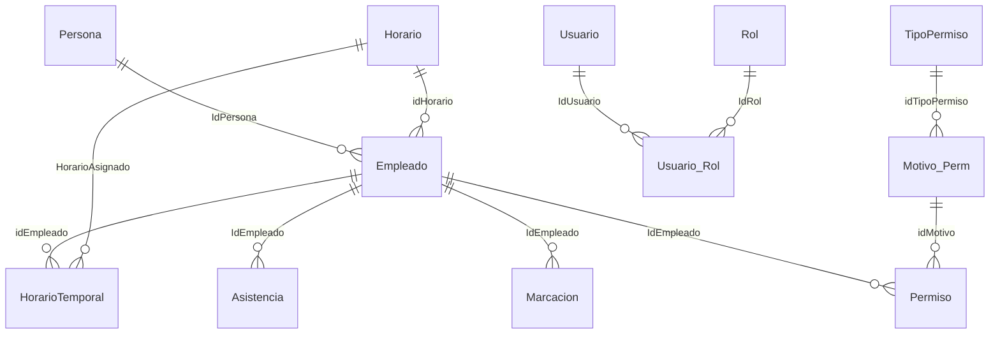

# 3. ACCESO A DATOS

[Volver al índice](../analisis_codex.md). Catálogo exhaustivo: [SQL](03_catalogo_sql.md), [procedimientos y LINQ](03_procedimientos_linq.md), [DDL y metadatos](03_modelo_datos.md).

| Ruta | Interpretación | Evidencia |
|---|---|---|
| Login actual | FrmLogin → CompositionRoot → ObtenerAccesoUsuario → PostgreSqlAccesoUsuarioRepository → PostgreSqlExecutor/Npgsql. Verifica hash/salt PBKDF2; no autentica por simple existencia del usuario. | [Software/RecursosHumanos/RecursosHumanos/FrmLogin.cs:108](../../Software/RecursosHumanos/RecursosHumanos/FrmLogin.cs#L108); [Software/RRHH.PostgreSql/Seguridad/PostgreSqlAccesoUsuarioRepository.cs:60](../../Software/RRHH.PostgreSql/Seguridad/PostgreSqlAccesoUsuarioRepository.cs#L60) |
| Catálogos/horarios/motivos/feriados migrados | Vista → Presenter → caso/contrato → repositorio concreto PostgreSQL. No afirmar ausencia total de capas. | [Software/RecursosHumanos/RecursosHumanos/CompositionRoot.cs:96](../../Software/RecursosHumanos/RecursosHumanos/CompositionRoot.cs#L96); [Software/RRHH.PostgreSql/Asistencia/PostgreSqlHorarioRepository.cs:14](../../Software/RRHH.PostgreSql/Asistencia/PostgreSqlHorarioRepository.cs#L14) |
| Mappers utilizados por formularios recuperados | PostgreSqlLegacyMapper comparte namespace/nombres de la API GRLL y genera SQL por reflexión. SelectBy usa SelectAll().Where en memoria. La DLL GRLL conserva los tipos originales y se silencia CS0436; la ruta no se determina por el nombre del mapper. | [Software/RecursosHumanos/RecursosHumanos/PostgreSqlLegacyMapper.cs:19](../../Software/RecursosHumanos/RecursosHumanos/PostgreSqlLegacyMapper.cs#L19); [Software/RecursosHumanos/RecursosHumanos/PostgreSqlLegacyMapper.cs:42](../../Software/RecursosHumanos/RecursosHumanos/PostgreSqlLegacyMapper.cs#L42); [Software/RecursosHumanos/RecursosHumanos.csproj:10](../../Software/RecursosHumanos/RecursosHumanos.csproj#L10) |
| Module1.DcGrll | Su tipo real es PostgreSqlLegacyContext: métodos con nombre spRRHH_* traducen a consultas locales o delegan en RRHHClass; spRRHH_GetReporteAsistencia es un stub que devuelve 0. | [Software/RecursosHumanos/RecursosHumanos/Module1.cs:11](../../Software/RecursosHumanos/RecursosHumanos/Module1.cs#L11); [Software/RecursosHumanos/RecursosHumanos/PostgreSqlLegacyContext.cs:82](../../Software/RecursosHumanos/RecursosHumanos/PostgreSqlLegacyContext.cs#L82) |
| Clase RRHHClass actual | Consultas parametrizadas, DataTable/DataSet y cálculos para formularios y reportes. Su nombre antiguo no implica SqlConnection actual. | [Software/ClassRRHH/ClassRRHH/RRHHClass.cs:14](../../Software/ClassRRHH/ClassRRHH/RRHHClass.cs#L14) |
| Access biométrico | OleDb con parámetros posicionales ?, lectura de empleado/asis_norm/marcacion; importación a PostgreSQL dentro de transacción. Varias escrituras a Access principal/alternativa no participan de la transacción PostgreSQL. | [Software/ClassRRHH/ClassRRHH/AsistenciaAccess.cs:133](../../Software/ClassRRHH/ClassRRHH/AsistenciaAccess.cs#L133); [Software/ClassRRHH/ClassRRHH/AsistenciaAccess.cs:106](../../Software/ClassRRHH/ClassRRHH/AsistenciaAccess.cs#L106) |
| Fuentes SQL Server recuperadas | clsConexion, GenericMapper&lt;DataContext&gt;, dcGRLLDataContext y TableAdapters contienen SqlClient, Function y SqlCommand/StoredProcedure. La app referencia GRLL.dll; el fuente GRLL.csproj no está en la solución. No se inspeccionó IL de esa DLL para confirmar equivalencia binaria. | [Software/GRLL/GRLL/Common/clsConexion.cs:17](../../Software/GRLL/GRLL/Common/clsConexion.cs#L17); [Software/GRLL/GRLL/Common/GenericMapper.cs:24](../../Software/GRLL/GRLL/Common/GenericMapper.cs#L24); [Software/GRLL/GRLL/Common/dcGRLLDataContext.cs:12](../../Software/GRLL/GRLL/Common/dcGRLLDataContext.cs#L12); [Software/RecursosHumanos/RecursosHumanos.csproj:27](../../Software/RecursosHumanos/RecursosHumanos.csproj#L27) |

## SQL, procedimientos y riesgo de inyección

El [catálogo SQL](03_catalogo_sql.md) reproduce todas las expresiones/plantillas SQL localizadas en C# y enumera las APIs de ejecución, incluidas las que reciben una variable. Conserva las expresiones y nombres; no inventa el SQL final de una cadena armada en ejecución. Los scripts SQL completos, con numeración original, figuran en el anexo de modelo.

Los 441 atributos Function del código recuperado describen nombres y parámetros de procedimientos o funciones SQL Server: 38 llevan IsComposable=true y 403 no llevan esa marca. **No contienen sus cuerpos T-SQL**. El inventario distingue los wrappers de llamadas y los nombres que hoy resuelve un puente C#. No es posible afirmar una lista completa de consultas internas del SQL Server original sin sus definiciones. [Software/GRLL/GRLL/Common/dcGRLLDataContext.cs:661](../../Software/GRLL/GRLL/Common/dcGRLLDataContext.cs#L661).

Interpolación de nombres de tabla/columnas no equivale automáticamente a inyección. Los repositorios usan @parámetros, IdentificadorSql valida identificadores simples y el mapper cita nombres obtenidos de metadatos. Hay que seguir el dato hasta su origen y ejecución. [Software/RRHH.PostgreSql/IdentificadorSql.cs:13](../../Software/RRHH.PostgreSql/IdentificadorSql.cs#L13); [Software/RecursosHumanos/RecursosHumanos/PostgreSqlLegacyMapper.cs:73](../../Software/RecursosHumanos/RecursosHumanos/PostgreSqlLegacyMapper.cs#L73).

Sí hay construcción de SQL con valores en los controles GRLL ucTViewNT y ucTViewVNT: concatenan nIdValorWhere/oNodo.Tag y fragmentos configurables en CommandText. Es un riesgo estático de inyección/errores de comillas si esos valores son controlables. No se demostró explotación ni alcanzabilidad de esos controles desde un menú RRHH actual. [Software/GRLL/GRLL/Common/ucTViewNT.cs:1294](../../Software/GRLL/GRLL/Common/ucTViewNT.cs#L1294); [Software/GRLL/GRLL/Common/ucTViewVNT.cs:1294](../../Software/GRLL/GRLL/Common/ucTViewVNT.cs#L1294).

## Esquema probable y relaciones

BD/schema.sql declara 105 CREATE TABLE, 4 apariciones de PRIMARY KEY y 0 de FOREIGN KEY. Se interpretan sólo como estado del archivo, sin inspeccionar restricciones del servidor desplegado. [BD/schema.sql:1](../../BD/schema.sql#L1).

| Relación inferida | Columnas / alcance | Evidencia |
|---|---|---|
| Persona → Empleado | IdPersona; identidad personal y vínculo laboral. | [Software/ClassRRHH/ClassRRHH/RRHHClass.cs:199](../../Software/ClassRRHH/ClassRRHH/RRHHClass.cs#L199) |
| Empleado → Horario | Empleado.idHorario; asignación principal. | [Software/RRHH.PostgreSql/Asistencia/PostgreSqlHorarioRepository.cs:102](../../Software/RRHH.PostgreSql/Asistencia/PostgreSqlHorarioRepository.cs#L102) |
| Empleado → HorarioTemporal → Horario | idEmpleado, N, FechaInicio/FechaFin y HorarioAsignado; asignaciones temporales existentes. | [Software/ClassRRHH/ClassRRHH/RRHHClass.cs:714](../../Software/ClassRRHH/ClassRRHH/RRHHClass.cs#L714); [Software/RecursosHumanos/RecursosHumanos/FrmHorarioEsp.cs:977](../../Software/RecursosHumanos/RecursosHumanos/FrmHorarioEsp.cs#L977) |
| Empleado → Asistencia / Marcacion | IdEmpleado, Fecha, horas y horario; el significado/clave difiere entre tabla de resumen y marcas individuales. | [Software/ClassRRHH/ClassRRHH/RRHHClass.cs:786](../../Software/ClassRRHH/ClassRRHH/RRHHClass.cs#L786); [Software/ClassRRHH/ClassRRHH/AsistenciaAccess.cs:133](../../Software/ClassRRHH/ClassRRHH/AsistenciaAccess.cs#L133) |
| Empleado → Permiso → Motivo_Perm → TipoPermiso | Fechas/horas/Dia/Retorno; catálogo y modalidad. Permiso_Aud mantiene motivos anterior/actual. | [Software/ClassRRHH/ClassRRHH/RRHHClass.cs:695](../../Software/ClassRRHH/ClassRRHH/RRHHClass.cs#L695); [Software/RRHH.PostgreSql/Permisos/PostgreSqlMotivoPermisoRepository.cs:112](../../Software/RRHH.PostgreSql/Permisos/PostgreSqlMotivoPermisoRepository.cs#L112) |
| Usuario → Usuario_Rol → Rol → sistema | Login, IdEmpleado, Estado, IdSistema y credenciales hash/salt; consulta ordena por IdRol y LIMIT 1. | [Software/RRHH.PostgreSql/Seguridad/PostgreSqlAccesoUsuarioRepository.cs:14](../../Software/RRHH.PostgreSql/Seguridad/PostgreSqlAccesoUsuarioRepository.cs#L14) |
| Empleado → Empleado_Area / EstructOrganiz / Local | Área por año y local; afecta filtros y reportes. | [Software/ClassRRHH/ClassRRHH/RRHHClass.cs:228](../../Software/ClassRRHH/ClassRRHH/RRHHClass.cs#L228) |
| RRHH_Feriado → calendario/reportes | Id, Fecha, Motivo. No se encontró integración de feriados en el cálculo LlenarPlanillaAsistencia actual. | [Software/RRHH.Domain/Asistencia/Feriado.cs:9](../../Software/RRHH.Domain/Asistencia/Feriado.cs#L9); [Software/ClassRRHH/ClassRRHH/RRHHClass.cs:786](../../Software/ClassRRHH/ClassRRHH/RRHHClass.cs#L786) |
| Empleado → ficha social y anexos | Familiares, estudios, experiencia, resoluciones, vivienda, salud, ingresos/egresos y otros módulos; esquema completo en el anexo. | [Software/ClassRRHH/ClassRRHH/RRHHClass.cs:1115](../../Software/ClassRRHH/ClassRRHH/RRHHClass.cs#L1115) |

Las cardinalidades son una hipótesis lógica derivada de columnas/joins, no FK observadas ni garantía de unicidad real. La consulta de catálogos registrada el 17/10 muestra IDs repetidos; no se reconsultó la BD durante este análisis. [docs/t2/evidencias/TEC-004/catalogos-solo-lectura.txt:16](../../docs/t2/evidencias/TEC-004/catalogos-solo-lectura.txt#L16).
