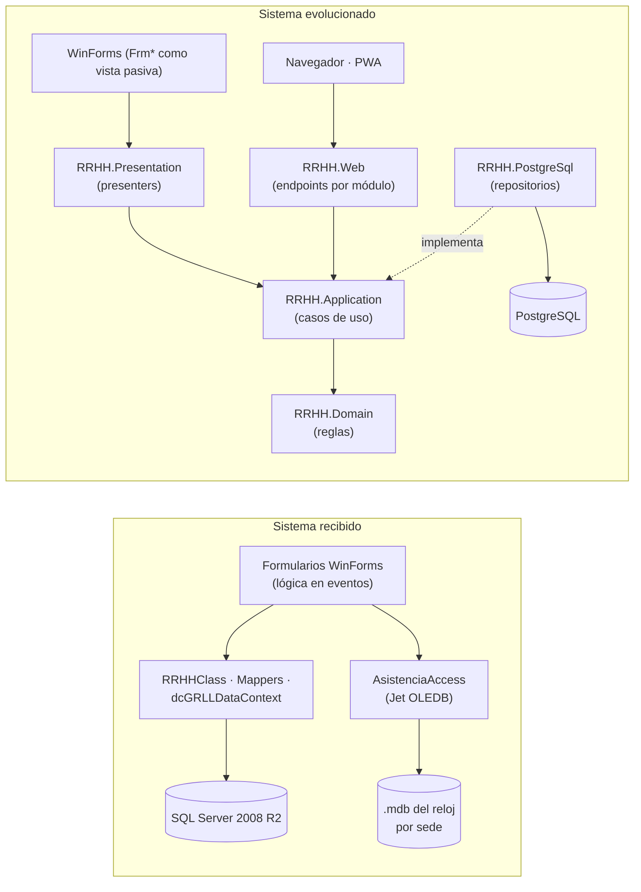
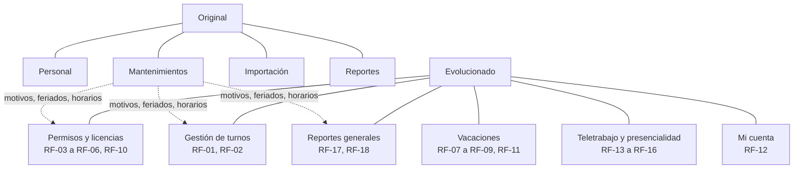
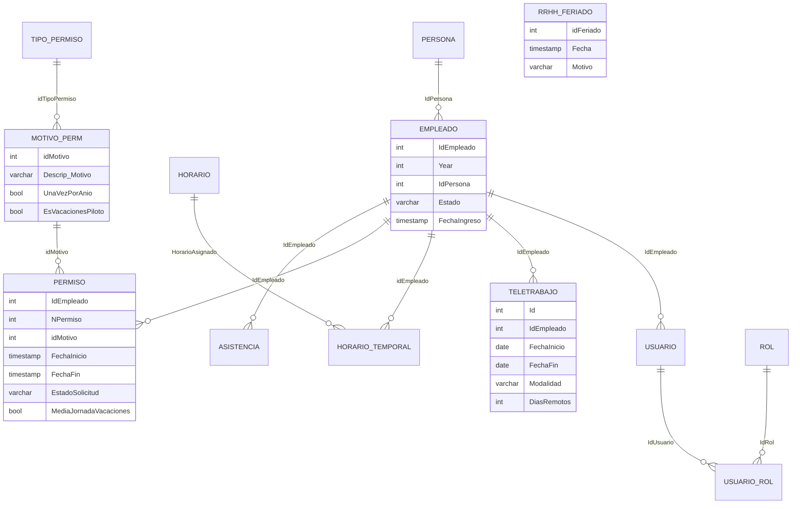
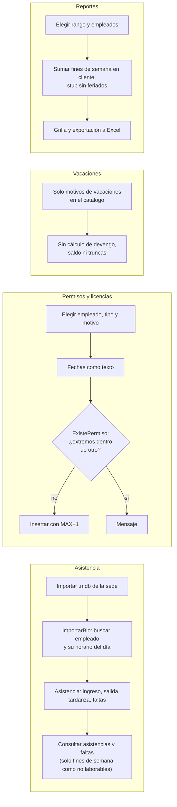

# Informe final: evolución integral del sistema RRHH

## 1. Carátula

| | |
|---|---|
| **Universidad** | Universidad Privada del Norte (UPN), Ingeniería de Sistemas Computacionales |
| **Curso** | Evolución y Configuración de Software, semestre 2026-1, ciclo X |
| **Docente** | Ing. Edgard Vilchez Valdez |
| **Evaluación** | Evaluación final: evolución integral de un sistema heredado de gestión de asistencias |
| **Integrantes** | Evelyn Victoria Rodriguez Cardozo · Jorge Enrique Cano Asto · Frank Piero Mantilla Arqueros · Francisco Kadin Valera Lizarraga |
| **Códigos** | *[completar cada integrante]* |
| **Repositorio** | https://github.com/Nidka/RRHH |
| **Versión entregada** | v1.7.0 (23/11/2026), desplegada en https://rrhh-web-ate6.onrender.com |
| **Fecha** | Noviembre de 2026 |

## 2. Resumen ejecutivo

- **Sistema recibido.** Una aplicación de escritorio WinForms para gestionar la asistencia del personal: fichas de personal, horarios, importación de marcaciones biométricas, permisos, feriados y reportes. Llegó como ensamblados compilados (origen Visual Basic .NET, 2013), con controles DevExpress 11.2 y base de datos SQL Server 2008 R2.
- **Problemas que tenía.**
  - Lógica de negocio dentro de eventos de botón: `btnGuardar_Click` de `FrmFichaSocial` ocupa 965 líneas.
  - Una clase central, `RRHHClass`, con responsabilidades mezcladas.
  - SQL incrustado y fechas comparadas como texto.
  - Detección incompleta de permisos solapados.
  - Códigos generados con `MAX+1` sin control de concurrencia.
  - Esquema sin claves foráneas declaradas.
  - Ninguna prueba automatizada.
- **Necesidad del área usuaria.** 18 requerimientos en cinco frentes: turnos, permisos y licencias, vacaciones, teletrabajo y presencialidad, y reportes generales e históricos.
- **Cambios implementados.**
  - Los 18 RF, con 19 solicitudes de cambio controladas (CR-001 a CR-019).
  - Disponibles en escritorio y en una versión web que reutiliza los mismos casos de uso.
- **Mejoras técnicas.**
  - Recuperación del código y migración del acceso a datos a PostgreSQL con SQL parametrizado.
  - Arquitectura por capas con MVP de vista pasiva.
  - Cinco refactorizaciones documentadas.
  - 427 pruebas automatizadas y 147 casos de prueba registrados.
  - Versionado semántico con 12 versiones etiquetadas, hasta v1.7.0, y despliegue de la web.
- **Versión que se entrega.** v1.7.0: los 18 RF de v1.6.0 más la navegación por módulos, el diseño moderno, el despliegue y la trazabilidad completa ([CHANGELOG](../../CHANGELOG.md)).

## 3. Descripción del sistema heredado

**Propósito.** Administrar la información del personal de la institución y su asistencia: registro de empleados, asignación de horarios, importación de marcaciones de relojes biométricos por sede, permisos y licencias, feriados y reportes de asistencia, faltas y permisos.

**Tecnologías utilizadas.**
- Windows Forms sobre .NET Framework (recuperado a C#, con huellas de Visual Basic .NET: `MyApplication`, `Conversions`, `StandardModule`).
- Controles DevExpress 11.2 (Grid, Editors, XtraReports).
- Bibliotecas propias GRLL.
- LINQ to SQL (`dcGRLLDataContext`, 441 contratos de procedimientos almacenados), mappers genéricos y SQL Server 2008 R2.
- Importación desde archivos Access (`.mdb`) mediante `Jet.OLEDB.4.0`.

Fuente: [análisis de ingeniería inversa](../analisis_codex.md), capítulo 1.

**Módulos existentes**, según el menú de `MainMDI`:

| Menú | Opciones |
|---|---|
| Personal | Relación de personal, búsqueda, nuevo personal, asignar horarios, asignar local |
| Mantenimientos | Cargos, grupos sanguíneos, condición laboral, nacionalidades, régimen de pensiones, estado civil, tipos de institución, documento y estudios, motivo y tipo de permiso, feriados, horarios |
| Importación | Asistencias por sede (SEDE, PROIND, CONSEJO, otros) y biométrico |
| Reportes | Lista de personal, cumpleaños, personal por oficina, fecha de ingreso, cargos y profesión, planilla de asistencias, faltas, permisos, asistencia del día, récord semanal |

En total, 87 clases de formulario y 12 reportes XtraReport ([fichas de formularios](../analisis_codex/02_formularios.md)).

**Procesos principales:**
1. Importar marcaciones del reloj de cada sede.
2. Consultar asistencia, faltas y horas trabajadas.
3. Registrar permisos y licencias con tipo y motivo.
4. Mantener catálogos, feriados y horarios.
5. Emitir reportes y exportarlos a Excel.

**Limitaciones encontradas:**
- No había turnos por periodo con histórico, cálculo de vacaciones, teletrabajo ni autoconsulta.
- El reporte general no consideraba los feriados: `spRRHH_GetReporteAsistencia` era un stub y solo se sumaban sábados y domingos.
- La validación de permisos solapados estaba incompleta.
- Las autorizaciones dependían de ocultar menús en el cliente.

**Estado inicial.** Código recuperado y compilable solo en Windows con DLL licenciadas, sin pruebas, con el esquema sin restricciones declaradas. La línea base es `v1.0.0` (18/10/2026).

## 4. Diagnóstico técnico inicial

Los hallazgos completos, con archivo y línea, están en [06_mantenibilidad.md](../analisis_codex/06_mantenibilidad.md) (H-01 a H-23) y en [ANALISIS_Y_PREPARACION_T2.md](../t2/ANALISIS_Y_PREPARACION_T2.md) (D-01 a D-12). Esta tabla cubre cada mala práctica que pide la evaluación:

| Problema encontrado | Ubicación | Impacto | Recomendación (y lo aplicado) |
|---|---|---|---|
| Código duplicado | 10 formularios `FrmMant*` con la misma lógica de alta y `Max()+1`; importación repetida por sede | Una corrección se hace 10 veces y diverge | Componente genérico de catálogos (REF-001); importación común propuesta |
| Métodos extensos | `FrmFichaSocial.btnGuardar_Click` (965 líneas), `llenda_datos_empleado` (634) | Cambios difíciles de aislar y probar | Extraer casos de uso; se aplicó en los flujos de los RF |
| Clases con demasiadas responsabilidades | `RRHHClass` (empleados, permisos, catálogos, reportes y asistencia); `MainMDI` (3 071 líneas) | Alto impacto de cada cambio | Servicios y repositorios por módulo (Application/PostgreSql) |
| Lógica de negocio en eventos de botón | `FrmFeriado.BtnAgregar_Click`, `FrmPermiso.Button1_Click` | Reglas imposibles de probar sin la pantalla | Presenter y caso de uso (REF-002, REF-003) |
| SQL incrustado | `AsistenciaAccess` (SQL concatenado), `ucTViewNT` (fragmentos SQL configurables) | Riesgo de inyección y errores de formato | Repositorios con SQL parametrizado (regla 3 de la arquitectura) |
| Falta de separación interfaz, negocio y datos | Formularios que llaman a `XxxMapper.Instance()` y a `RRHHClass` | Acoplamiento a la base de datos y a WinForms | Capas Domain, Application, Presentation y PostgreSql, verificadas por `DependenciasEntreCapasTests` |
| Validaciones repetidas o incompletas | `ExistePermiso` no detecta contención (D-02); fechas comparadas como texto (D-03); `HorarioEsp` valida solo al crear | Permisos y turnos solapados | `RangoFechas` único con extremos inclusivos (PR #18, #19) |
| Nombres poco claros | `llena_leriado`, variable `y` en `FrmMantCargos`, campo `Npermiso` usado para horarios, `Button1_Click` | Lectura y soporte difíciles | Nombres de negocio en el código nuevo (`ValidarPermisoSinSolapamiento`, `CalendarioLaboral`) |
| Bajo nivel de reutilización | Cada pantalla consultaba feriados y fechas por su cuenta | Reglas distintas para el mismo concepto | `CalendarioLaboral` y `CalcularDiasNoLaborables` reutilizados por RF-14, RF-16 y RF-17 |
| Dificultad para agregar requerimientos | Sin pruebas, sin capas, códigos `MAX+1` y sin PK/FK | Riesgo alto de regresión | Pruebas antes de cambiar, migraciones y transacciones (TEC-002) |

## 5. Ingeniería inversa del sistema

**Diagrama general del sistema** (antes y después de la evolución):

**Diagrama de módulos** (los nuevos sobre el original):

**Tablas principales.** Están identificadas en `BD/schema.sql` y en las consultas de los repositorios. El esquema original no declaraba claves foráneas (D-04); TEC-002 agregó restricciones en las tablas tocadas ([diagrama de TEC-002](../t2/diagramas/TEC-002/ENTIDAD_RELACION.md)).

**Flujos actuales del sistema recibido** (detalle y fuentes en los documentos enlazados):

Fuentes: [flujo de asistencia](../t2/diagramas/TEC-003/flujo-asistencia.md), [flujo de reportes](../t2/diagramas/TEC-003/flujo-reportes.md) y [flujos de permisos, licencias y vacaciones](../t2/diagramas/TEC-004/FLUJOS_FUNCIONALES.md). Las licencias usan el mismo flujo de permisos, con tipo «LICENCIA» en el catálogo. El enunciado indica que el sistema heredado no tenía motor de vacaciones, y el análisis lo confirmó con búsquedas negativas ([04_reglas_negocio.md](../analisis_codex/04_reglas_negocio.md)).

**Reglas de negocio identificadas:**
- **En el original:**
  - Tardanza si la marcación supera el ingreso más 5 minutos de tolerancia.
  - Clasificación de la marcación por turno (mañana o tarde).
  - Un permiso se rechaza si sus extremos caen dentro de otro (regla incompleta).
  - No se registran dos feriados en la misma fecha.
  - Sábados y domingos se suman como asistidos en el modo «Asistencias».
  - Visibilidad de menús según el rol.
- **Incorporadas en la evolución:**
  - Solapamiento inclusivo de fechas, incluida la contención.
  - Licencia una vez por año, por motivo y por grupo.
  - Cada fecha se cuenta una sola vez en el reporte general.
  - Estados del permiso: Solicitado y Aprobado reservan; Rechazado y Anulado liberan.
  - Vacaciones por aniversario completo con régimen parametrizable, y media jornada de 0,5 días.
  - Truncas proporcionales al cese incluido.
  - Teletrabajo total o parcial por patrón de días.
  - Una categoría por día en la presencialidad.
  - Autoconsulta limitada a la propia cuenta.

## 6. Requerimientos del área usuaria

| Módulo | Código | Requerimiento |
|---|---|---|
| A. Gestión de turnos | RF-01 | Registrar turnos por periodos de fechas (solo algunos trabajadores; la mayoría tiene un turno estable) |
| | RF-02 | Consultar el histórico de turnos |
| B. Permisos y licencias | RF-03 | Impedir dos permisos el mismo día para una persona |
| | RF-04 | Agregar motivos de permiso |
| | RF-05 | Eliminar motivos de permiso |
| | RF-06 | Validar licencias que se otorgan una vez al año (por ejemplo, Ley 30012) |
| C. Vacaciones | RF-07 | Reportar vacaciones generadas |
| | RF-08 | Reportar vacaciones pendientes de goce |
| | RF-09 | Reportar vacaciones truncas |
| | RF-10 | Contabilizar vacaciones desde media jornada |
| | RF-11 | Generar reporte de vacaciones |
| | RF-12 | Módulo de autoconsulta de vacaciones pendientes y usadas |
| D. Teletrabajo y presencialidad | RF-13 | Registrar periodos de teletrabajo (periodos y días) |
| | RF-14 | Reportar días de teletrabajo |
| | RF-15 | Reportar labores presenciales y días de teletrabajo por persona |
| | RF-16 | Reportar quiénes realizan teletrabajo total o parcial |
| E. Reportes generales | RF-17 | Validar que los feriados se sumen correctamente en el reporte general |
| | RF-18 | Reportar quiénes están de vacaciones, licencia, enfermedad u otro motivo entre fechas |

Análisis de datos, dependencias y criterios: [MATRIZ_REQUERIMIENTOS.csv](../t2/MATRIZ_REQUERIMIENTOS.csv).

## 7. Plan de mantenimiento

El plan completo está en [PLAN_MANTENIMIENTO.md](PLAN_MANTENIMIENTO.md):
- **Objetivo:** atender los 18 RF reduciendo la deuda técnica que impedía cambiar el sistema con seguridad.
- **Alcance:** los casos de uso de los RF, en escritorio y web; los formularios heredados quedan congelados.
- **Tipos de mantenimiento:**
  - correctivo: RF-03, RF-17 y RF-18;
  - adaptativo: PostgreSQL, RF-01, RF-06, RF-10, RF-13 y la web;
  - perfectivo: reportes, autoconsulta y CR-019;
  - preventivo: TEC-001 a TEC-004, REF-001 a REF-005 y las pruebas.
- **Priorización:** P1 para bases y defectos; P2 para reportes y cálculos dependientes; P3 para la autoconsulta.
- **Riesgos:** diferencias con el original, reglas de vacaciones sin confirmar, DLL solo para Windows, revisión cruzada insuficiente y despliegue manual.
- **Estrategia de refactorización:** caso de uso completo, caracterizar antes de cambiar y separar lo conservado de lo corregido.
- **Estrategia de pruebas:** unitarias, de integración en PostgreSQL, de arquitectura, de caracterización de la API, extremo a extremo y de humo.
- **Responsables y cronograma:** según el historial real (sección 8 del plan).

## 8. Matriz de control de cambios

Matriz completa con tipo, riesgo, responsables, PR, revisión registrada, casos y evidencia: [CONTROL_CAMBIOS.csv](../t2/CONTROL_CAMBIOS.csv). Resumen:

| Código | Solicitud de cambio | Prioridad | Estado | Responsable | Evidencia | Commit |
|---|---|---|---|---|---|---|
| CR-001 | Turnos por periodos | P1 | Implementado (v1.4.0) | Evelyn; Jorge (web) | CP-01-01 a CP-01-W1 | `5e91030`, `e18e928` |
| CR-002 | Histórico de turnos | P2 | Implementado (v1.4.0) | Evelyn; Jorge (web) | CP-02-01 a CP-02-W1 | `45752cb`, `3f54192` |
| CR-003 | Evitar dos permisos el mismo día | P1 | Implementado (v1.0.2, v1.6.0) | Frank; Jorge | CP-03-01 a CP-03-10 | `ce30c00`, `f496a90` |
| CR-004 | Agregar motivos | P1 | Implementado (TEC-004) | Evelyn; Jorge (web) | CP-04-01 a CP-04-W1 | `06ca7f6`, `f1796af` |
| CR-005 | Eliminar motivos | P1 | Implementado (TEC-004) | Evelyn; Jorge (web) | CP-05-01 a CP-05-W1 | `06ca7f6`, `f1796af` |
| CR-006 | Licencia una vez por año | P1 | Implementado (v1.1.0, v1.6.0) | Frank; Kadin; Jorge | CP-06-01 a CP-06-08 | `af63b29`, `a1abb6a` |
| CR-007 | Vacaciones generadas | P1 | Implementado (v1.6.0) | Jorge | CP-07-01 a CP-07-W1 | `ef45313` |
| CR-008 | Vacaciones pendientes | P2 | Implementado (v1.6.0) | Jorge | CP-08-01 a CP-08-03 | `4334c6a` |
| CR-009 | Vacaciones truncas | P2 | Implementado (v1.6.0) | Jorge | CP-09-01 a CP-09-W1 | `f427d11` |
| CR-010 | Consumo desde media jornada | P1 | Implementado (v1.6.0) | Jorge | CP-10-01 a CP-10-W1 | `6256cd6` |
| CR-011 | Reporte de vacaciones | P2 | Implementado (v1.6.0) | Jorge | CP-11-01 a CP-11-W1 | `7c57f7f` |
| CR-012 | Autoconsulta de vacaciones | P3 | Implementado (v1.6.0) | Jorge | CP-12-01 a CP-12-W1 | `bf086dd` |
| CR-013 | Registrar teletrabajo | P1 | Implementado (v1.3.0) | Jorge; Kadin (tabla) | CP-13-01 a CP-13-09 | `e2defa4` |
| CR-014 | Días de teletrabajo | P2 | Implementado (v1.3.0) | Jorge | CP-14-01 a CP-14-05 | `3ed6684` |
| CR-015 | Presencialidad y teletrabajo | P2 | Implementado (v1.6.0) | Jorge | CP-15-01 a CP-15-W1 | `5927135` |
| CR-016 | Teletrabajo total o parcial | P2 | Implementado (v1.5.0) | Kadin; Jorge (web) | CP-16-01 a CP-16-17 | `80450af` |
| CR-017 | Feriados en el reporte general | P1 | Implementado (v1.0.3, v1.6.0) | Frank; Jorge | CP-17-01 a CP-17-11 | `cd4e46d`, `2d86eae` |
| CR-018 | Ausentes por motivo y periodo | P2 | Implementado (v1.2.0, v1.6.0) | Kadin; Jorge | CP-18-01 a CP-18-S2 | `11b2429`, `2bfbbe2` |
| CR-019 | Navegación por módulos y diseño web | P1 | Implementado en web (v1.7.0); escritorio pendiente | Evelyn | CP-19-01 a CP-19-15 | `87d0fde`, `d97c020` (PR #76, #77) |

**Trazabilidad:** requerimiento (RF) → solicitud (CR) → spec en `specs/` → implementación (commit) → PR → prueba (CP) → evidencia. Cada eslabón está enlazado en la matriz.

## 9. Evidencias de refactorización

Fichas con el código antes y después extraído de Git: [docs/t3/refactorizaciones](../t3/refactorizaciones/README.md).

| Código | Problema | Refactorización aplicada | Principio aplicado | Beneficio |
|---|---|---|---|---|
| REF-001 | 10 catálogos con la misma lógica y `Max()+1` | Componente MVP genérico definido por datos | DRY · Abierto/Cerrado | Una implementación para 10 catálogos, probada sin WinForms |
| REF-002 | Feriados validados y guardados en el evento del botón | Entidad, casos de uso, presenter y repositorio transaccional | Responsabilidad única · Separación de capas | Duplicados controlados; feriados reutilizados por RF-14, RF-16 y RF-17 |
| REF-003 | Motivos: la carga escribía en la base | Vista pasiva, presenter y repositorio | Responsabilidad única · Inversión de control | Cargar o cancelar ya no escribe |
| REF-004 | Horarios con mapper y `MAX+1` en el formulario | MVP con repositorio PostgreSQL | Separación del acceso a datos | Comportamiento conservado y probado |
| REF-005 | Web sin navegación, todo en dos archivos | Catálogo de módulos, API por módulo y componentes | Abierto/Cerrado · DRY | Una pantalla nueva es una entrada y un archivo |

## 10. Gestión de configuración y versiones

- **Repositorio:** https://github.com/Nidka/RRHH (GitHub), más de 200 commits en `main` y 72 PR integrados.
- **Estructura de ramas:** `main` se integra mediante PR, aunque la rama no tiene una regla de protección configurada en GitHub (ver recomendación 1). Una rama por tarea con prefijo `feature/`, `fix/`, `refactor/`, `infra/`, `docs/` o `release/`, vinculada a un RF, CR o TEC (por ejemplo, `feature/rf-01-turnos-por-periodo` o `fix/rf-03-permisos-solapados`). Reglas en [CONTRIBUTING.md](../../CONTRIBUTING.md).
- **Convención de commits:** `tipo(ALCANCE): descripción`, más un pie `Refs: RF-NN, CR-0NN, CP-NN-nn`. Tipos: `feat`, `fix`, `refactor`, `test`, `docs`, `infra`. Ejemplo: `fix(RF-03): detectar permisos solapados que contienen a otro`. La ayuda de IA se declara en el PR, no en el commit.
- **Commits principales:**
  - `0a4b6a8`: arquitectura MVP y catálogos.
  - `ce30c00`: solapamiento de RF-03.
  - `5e91030`: turnos por periodo.
  - `cd4e46d`: feriados en el reporte.
  - `ef45313`: vacaciones generadas.
  - `87d0fde`: API por módulo.
  - `d97c020`: diseño moderno.
- **Releases** (etiquetas anotadas y Releases de GitHub; política en [POLITICA_VERSIONADO.md](../versionado/POLITICA_VERSIONADO.md)):
  - v1.0.0 (18/10): solución recuperada;
  - v1.0.1 a v1.0.3: correcciones de integridad, RF-03 y RF-17;
  - v1.1.0: RF-06;
  - v1.2.0: RF-18;
  - v1.3.0: RF-13 y RF-14;
  - v1.4.0: RF-01 y RF-02;
  - v1.5.0: RF-16;
  - v1.6.0-beta.1 y v1.6.0 (20/11): web y vacaciones;
  - v1.7.0 (23/11): despliegue de la web, navegación por módulos, diseño moderno y trazabilidad final.
- **Changelog:** [CHANGELOG.md](../../CHANGELOG.md), en formato Keep a Changelog.
- **Participación de integrantes** (commits propios sin merges, con `.mailmap` para unificar alias):

| Integrante | Commits | PR propios integrados | Aporte principal |
|---|---|---|---|
| Jorge Enrique Cano Asto | 46 | 47 | RF-07 a RF-15, versión web, QA de aceptación |
| Francisco Kadin Valera Lizarraga | 41 | 11 | BD y migraciones, RF-16, RF-18, versionado y despliegue |
| Evelyn Victoria Rodriguez Cardozo | 25 | 9 | RF-01, RF-02, RF-04, RF-05, CR-019, trazabilidad final |
| Frank Piero Mantilla Arqueros | 13 | 5 | RF-03, RF-06, RF-17, base de calendario, REF-001, REF-002 |

**Revisión cruzada.** Entre los PR de los 18 RF, solo el #20 y el #21 tienen una aprobación formal registrada en GitHub. En el resto, la matriz indica quién integró el PR. Lo informamos tal cual, como parte de las lecciones aprendidas.

## 11. Resultados obtenidos

| Indicador | Resultado | Evidencia |
|---|---|---|
| Requerimientos implementados | 18 de 18, en escritorio y web | [Matriz de aceptación](MATRIZ_ACEPTACION_RF.md) |
| Solicitudes de cambio controladas | 19 (CR-001 a CR-019) | [Matriz de cambios](../t2/CONTROL_CAMBIOS.csv) |
| Pruebas automatizadas | 427 de 427 superadas (unitarias, integración en PostgreSQL y arquitectura) | [Ejecución net8](../t3/evidencias/SUITE/ejecucion-net8-c79949b.txt) |
| Casos de prueba registrados | 147, todos con resultado y evidencia | [CASOS_DE_PRUEBA.csv](../t3/CASOS_DE_PRUEBA.csv) |
| Escenarios del enunciado | Turnos por rango, histórico, dos permisos el mismo día, licencia anual repetida, vacaciones generadas, pendientes, truncas y media jornada, feriados, teletrabajo, presencialidad, ausencias entre fechas, **asistencia desde 2008**, motivos y autoconsulta | CP-01 a CP-19 (2008: CP-17-08 a CP-17-10) |
| Refactorizaciones | 5 documentadas con código antes y después | [Refactorizaciones](../t3/refactorizaciones/README.md) |
| Regresión de la API web | 73 de 77 respuestas idénticas; solo difiere la ruta nueva | [CR-019](../../qa/evidencias/cr-019/README.md) |
| Interfaz web | 61 de 61 verificaciones en Chrome con 3 roles y celular | [Recorrido](../../qa/evidencias/cr-019/recorrido-web-resultado.txt) |
| Despliegue | Web en Render con base en Neon; prueba de humo 9/9 | [DESPLIEGUE.md](../despliegue/DESPLIEGUE.md) |

## 12. Conclusiones

1. **Primero hacer el sistema seguro de cambiar.** Evolucionar un sistema heredado requirió recuperarlo, entenderlo y darle pruebas antes de agregar funciones. Los RF más rápidos de implementar fueron los que se apoyaron en las bases preventivas (`RangoFechas`, `CalendarioLaboral`, repositorios).
2. **Las capas dieron resultado medible.** La web reutiliza los mismos casos de uso que el escritorio, sin duplicar reglas. La regla de solapamiento se escribió una vez y la usan RF-01, RF-03, RF-13 y RF-18.
3. **Caracterizar evitó regresiones.** Comparar las respuestas antes y después (61/61 y 73/77) demostró que las refactorizaciones de CR-019 no cambiaron el comportamiento existente.
4. **El control de cambios exige constancia.** La matriz llegó a estar desactualizada (CR-007 a CR-015 «pendientes» con el código ya en `main`). Se corrigió reconstruyendo la trazabilidad desde el historial de Git.
5. **El versionado semántico dejó una historia legible.** Doce versiones etiquetadas, con su release y su entrada en el changelog, permiten explicar qué cambió y cuándo.

## 13. Recomendaciones

1. **Revisión cruzada formal obligatoria** antes de integrar a `main`: proteger la rama con al menos una aprobación de otro integrante.
2. **Validar con el área usuaria** las reglas que hoy son supuestos académicos: régimen de vacaciones, alcance de la Ley 30012 y política de anulación.
3. **Completar CR-019 en escritorio** (menú por módulos y selector de empleado en WinForms) en un equipo Windows, y repetir el QA visual.
4. **Activar el despliegue automático** o un flujo de integración continua que ejecute la suite y la prueba de humo en cada PR.
5. **Continuar la migración** de los flujos heredados restantes (ficha de personal, importación por sede) con la misma estrategia, y agregar claves foráneas al resto del esquema.
6. **Reemplazar la autorización por ocultamiento de menús** con autorización por operación en todos los repositorios.

## 14. Anexos

- **A. Ingeniería inversa:** [análisis completo](../analisis_codex.md), [diagramas T2](../t2/diagramas), [reglas de negocio](../analisis_codex/04_reglas_negocio.md).
- **B. Arquitectura:** [ARQUITECTURA.md](../../Software/docs/ARQUITECTURA.md), [ADR 0001](../../Software/docs/adr/0001-mvp-sobre-capas.md), [ADR 0002](../../Software/docs/adr/0002-web-y-pwa.md).
- **C. Specs por cambio:** [specs/](../../specs/README.md).
- **D. Evidencias de pruebas:** [suite](../t3/evidencias/SUITE/), [QA de escritorio](../../qa/evidencias/20261120-winforms/README.md), [QA final](../../qa/evidencias/20261119-final/), [CR-019](../../qa/evidencias/cr-019/README.md).
- **E. Versionado:** [política](../versionado/POLITICA_VERSIONADO.md), [registro de versiones](../versionado/REGISTRO_VERSIONES.md), [CHANGELOG](../../CHANGELOG.md).
- **F. Despliegue:** [guía](../despliegue/DESPLIEGUE.md), [lista de despliegue](../despliegue/CHECKLIST.md).
- **G. Uso de IA:** cada PR declara la ayuda recibida y cómo se verificó. Las fichas y la matriz distinguen lo observado, lo inferido y lo pendiente.
