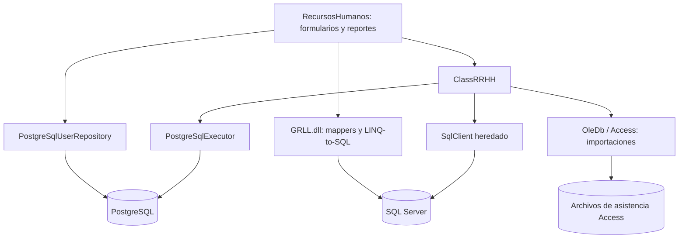

# Análisis del proyecto y preparación de T2

> **Referencia histórica:** este análisis describe `e725cd6`. Desde `0a4b6a8` existen capas MVP, diez catálogos migrados y un proyecto de pruebas. Para el estado vigente y el reparto nominal usar [README T2](README.md), [estado actualizado](ESTADO_0a4b6a8.md) y [plan del equipo](PLAN_EQUIPO.md). Las asignaciones A–D y la ausencia de pruebas indicadas abajo corresponden a la revisión anterior, no al estado actual.

Fecha de revisión: 15 de octubre de 2026. Base revisada: commit `e725cd6`.

Este es un documento de trabajo, no un informe T2 terminado. Se basa en la lectura de los dos PDF y en inspección estática del repositorio. Las propuestas, estimaciones y criterios siguientes son recomendaciones para el equipo, no instrucciones adicionales del docente ni funcionalidades verificadas en ejecución. No se modificó el código de la aplicación.

## 1. Qué exige la evaluación

Fuentes locales:

- `Evaluación PrácticaT2.pdf`: nueve páginas; actividades en pp. 1–5, estructura del informe en pp. 5–6, rúbricas en pp. 7–9.
- `226434ISOF1521A.pdf`: sílabo, tres páginas; calendario y pesos en p. 2.

La T2 se titula «Diagnóstico, ingeniería inversa y planificación de la evolución del sistema de gestión de asistencias». El ejecutable recibido corresponde a Windows Forms con SQL Server 2008 R2 y sin entrega del código original. La recuperación de código está permitida como apoyo académico, pero se evalúan la calidad del análisis y su evidencia, no solamente haberlo recuperado.

Los 18 RF deben analizarse; su implementación completa no es obligatoria en T2. La implementación progresiva corresponde a T3 y Evaluación Final. El sílabo ubica T2 en semana 10 con peso 20%; T3 en semana 13 con 30%; final en semana 16 con 40%; T1 pesa 10%. Los documentos no fijan una fecha calendario de entrega ni duración de exposición.

| Actividad obligatoria | Evidencia que debe preparar el equipo | Situación local |
|---|---|---|
| Explorar el ejecutable | Capturas, menús, botones, datos, errores, restricciones y pruebas controladas | Hay formularios recuperados; falta evidencia de exploración en el repositorio |
| Ingeniería inversa funcional | Mapa, módulos, flujos de asistencia, permisos, licencias, vacaciones y reportes; reglas y entradas/procesos/salidas | El código permite empezar el mapa; faltan diagramas y validación ejecutando el original |
| Ingeniería inversa técnica | Inventario de archivos originales, dependencias, configuración, entidades, método y limitaciones | Hay código, proyectos y documentación técnica; falta reconstruir y documentar el proceso completo |
| Diagnóstico | Cada problema con descripción, evidencia, impacto y recomendación | Hallazgos iniciales en este documento |
| Analizar los 18 RF | Módulo, mantenimiento, prioridad, complejidad, riesgo, datos, dependencias, impacto y aceptación | Propuesta inicial abajo; requiere validación del equipo |
| Plan de mantenimiento | Objetivo, alcance, riesgos, estrategias, responsables, cronograma y aceptación | Propuesta inicial abajo |
| Control de cambios | Una solicitud por RF, con código, tipo, prioridad, riesgo, responsable y estado | Correspondencia CR-001…CR-018 propuesta; faltan responsables nominales |
| Refactorización/reconstrucción | Al menos cuatro propuestas con problema, evidencia, principio, beneficio y RF | Seis propuestas abajo |
| Repositorio privado y colaborativo | README, integrantes, informe, capturas, diagramas, matrices, plan, propuestas y evidencias | Repositorio existente; no se verificó privacidad ni acceso del docente |

El docente solicita agregar `evilchez@outlook.com` y `edgard.vilchez@upn.pe` al repositorio privado. Esto es un pendiente para el equipo: esta revisión no envió invitaciones ni cambió permisos.

La rúbrica del informe distribuye 20 puntos en cuatro categorías de 5: ingeniería inversa; diagnóstico; requerimientos/plan/control de cambios; informe/repositorio/evidencias. La exposición tiene 15 puntos por claridad y dominio y 5 por comunicación profesional. Exige diapositivas organizadas, visuales y sin exceso de texto; contempla descontar hasta 5 puntos por presentación personal o desorganización. Aunque las rúbricas usan títulos de proyecto «final», están incluidas en el documento T2: conviene confirmar su aplicación exacta con el docente.

## 2. Qué contiene realmente el proyecto

Inventario estático: 1 048 archivos C# en nueve carpetas de proyectos; ocho proyectos C# incluidos en `Software/RRHH.sln`. Aproximadamente 312 mil líneas, incluyendo abundante código generado y de interfaz: no representan líneas escritas por el equipo ni una medida de calidad.

| Componente | Función identificada | Observación |
|---|---|---|
| RecursosHumanos | Aplicación WinForms, formularios y reportes | 125 archivos C#; contiene acceso a datos y decisiones de negocio en formularios |
| ClassRRHH | Operaciones de empleados, asistencia, permisos, familiares y ficha social | Conviven operaciones Npgsql y SqlClient |
| RRHH.PostgreSql | Conexiones, consultas parametrizadas y transacciones | Nueva base para migración gradual; no reemplaza todos los accesos heredados |
| GRLL | Entidades, mappers, contexto LINQ-to-SQL y controles compartidos | 858 archivos; fuente excluida de la solución, que usa `lib/legacy/GRLL.dll` |
| Seguridad | Cifrado/descifrado heredado | Usa DES; revisar consumidores antes de reemplazar |
| ClsCtrls, TabStrip, CustomFeaturedMessageBox, GRLL.Common.Rutinas | Controles y utilidades | Soporte de la aplicación antigua |
| BD/schema.sql | Estructura PostgreSQL disponible | 101 tablas; sin declaraciones de PK, FK, índices, vistas, funciones o procedimientos |

Arquitectura identificada en código:

Esto describe dependencias observadas; no acredita que todas esas rutas funcionen hoy.

El menú recuperado en `MainMDI.cs` incluye personal, búsqueda y alta, asignación de horarios/local, catálogos, motivos/tipos de permiso, feriados, horarios, importaciones SEDE/PROIND/CONSEJO/OTROS/biométrico y reportes de personal, asistencias, faltas y permisos. También aparecen ficha social y familiares entre los formularios. Los flujos de vacaciones, licencias y teletrabajo deben localizarse y probarse; no se deben declarar existentes ni ausentes basándose solamente en nombres de archivos.

La lectura actual muestra más avance que la descripción «solo login» del README: `RRHHClass` contiene búsquedas de empleados y altas/actualizaciones transaccionales en PostgreSQL; `FamiliaresClass` y `FichaSocialClass` también consultan PostgreSQL. Actualizar esa descripción con evidencia de pruebas cuando se valide. Las cifras del documento previo de migración tampoco coinciden exactamente con el código actual: esta revisión encontró 39 archivos con tipos SqlConnection/SqlCommand/SqlDataAdapter y 806 con referencias a LINQ-to-SQL/contexto. Son indicadores estáticos, no porcentajes de migración.

No pude compilar ni ejecutar la interfaz: este entorno macOS no tiene `dotnet` ni `msbuild`, y la aplicación requiere Windows/.NET Framework y dependencias heredadas. «0 errores» es un estado declarado por el README, no revalidado en esta revisión. Tampoco inspeccioné datos personales ni contrasté el esquema con una instancia activa. Las cantidades sobre la base SQL Server original que aparecen en la documentación existente no se revalidaron aquí.

## 3. Diagnóstico con evidencia local

| ID | Problema y evidencia | Impacto | Recomendación |
|---|---|---|---|
| D-01 | `FrmPermiso.cs`, aprox. 1538–1553: verifica existencia vía `RRHHClass` pero inserta mediante `PermisoMapper`; `RRHHClass.ExistePermiso` consulta PostgreSQL | La validación y la escritura pueden usar motores distintos; riesgo de resultados incoherentes o fallo | Una única ruta transaccional por caso de uso; comprobar proveedores reales en ejecución |
| D-02 | `RRHHClass.ExistePermiso`, aprox. 268: busca extremos nuevos dentro del permiso existente | No detecta cuando el intervalo nuevo contiene completamente al anterior | Comparar inicioNuevo <= finExistente y finNuevo >= inicioExistente; probar igualdad, contención y solapamientos; definir límites horarios |
| D-03 | `FrmPermiso.cs`, aprox. 1449: compara fechas convertidas a cadenas locales | El orden de cadenas puede diferir del orden de fechas; dependencia del formato regional | Operar con tipos fecha/hora y parámetros tipados; reproducir el caso en el original |
| D-04 | `BD/schema.sql`: 101 CREATE TABLE y ninguna PK/FK/índice declarado | No hay garantías declaradas de integridad en ese archivo; rendimiento y consistencia en riesgo | Perfilar datos y reconstruir restricciones mediante migraciones; verificar primero la base activa |
| D-05 | `RRHHClass.cs`: empleados, permisos, catálogos, reportes y asistencia en una misma clase; firmas con muchos parámetros | Cambios de alto impacto y pruebas difíciles | Separar servicios y repositorios por responsabilidad, introducir objetos de entrada |
| D-06 | `AsistenciaAccess.cs`, p. ej. 140–172: SQL concatenado y varias rutas de importación similares | Riesgo de errores de formato, inyección y correcciones divergentes | Parametrizar y extraer importación común con adaptadores por origen |
| D-07 | `FrmLogin.cs` solicita solo nombre; repositorio selecciona perfil/rol activo | La selección de perfil no verifica identidad del usuario final | Explicar limitación de desarrollo y planificar autenticación verificable y autorización |
| D-08 | `.csproj` apunta a `lib/legacy/GRLL.dll` y DevExpress 11.2; GRLL fuente fuera de la solución | Compilar los proyectos incluidos no acredita reconstrucción íntegra desde fuente ni portabilidad | Inventariar versiones, preparar dependencias y aislar su reemplazo gradual |
| D-09 | `SgtIdPermiso` y `SgtIdHorarioTemporal` usan MAX+1; alta de empleado usa bloqueo asesor como solución provisional | Riesgo de colisión con escritores que no comparten la coordinación | Secuencias/identidad, restricciones y pruebas concurrentes |
| D-10 | `RRHHClass` inicializa año 2011 y contiene comentarios de migración que generalizan más que sus métodos | Dependencia de supuestos históricos y documentación desalineada | Identificar dónde se sustituye el año, probar periodos y sincronizar documentación |
| D-11 | `Seguridad.cs` contiene DES y modo ECB predeterminado | Riesgo si sigue protegiendo secretos activos | Localizar consumidores, definir reemplazo y compatibilidad de datos antes del cambio |
| D-12 | No se encontraron proyectos de pruebas ni paquete T2; cuatro commits locales figuran bajo autor Nidka | Falta evidencia automatizada y de participación individual suficiente para la entrega | Pruebas de caracterización, tareas y revisiones reales por integrante; no fabricar historial |

Los defectos deducidos del código recuperado se deben contrastar con el ejecutable original: un problema de reconstrucción/migración puede no existir en el producto recibido. Documentar procedencia y versión en cada evidencia.

## 4. Análisis inicial de los 18 requerimientos

Clasificación propuesta, revisable después de explorar el original. P1 = primero; P2 = después de bases y reglas; P3 = después de disponer de cálculos y acceso. A/M/B = alta/media/baja. Correctivo corrige comportamiento defectuoso; adaptativo atiende cambios del entorno/reglas; perfectivo amplía capacidad. El mantenimiento preventivo se aplica además a las mejoras técnicas transversales.

| RF / CR | Descripción resumida | Módulo | Tipo propuesto | Prioridad | Complejidad | Riesgo | Impacto esperado |
|---|---|---|---|---|---|---|---|
| RF-01 / CR-001 | Turnos por periodos | Horarios/asistencia | Adaptativo | P1 | M | M | Asignaciones por rango, conflictos y calendario |
| RF-02 / CR-002 | Histórico de turnos | Horarios | Perfectivo | P2 | M | M | Conservar vigencias y consultar cambios |
| RF-03 / CR-003 | Evitar dos permisos el mismo día | Permisos | Correctivo | P1 | M | A | Validación temporal común y escritura consistente |
| RF-04 / CR-004 | Agregar motivos | Catálogos/permisos | Perfectivo* | P1 | B | M | Alta de motivos y validación de duplicados |
| RF-05 / CR-005 | Eliminar motivos | Catálogos/permisos | Perfectivo* | P1 | M | A | Integridad histórica; acordar baja lógica si tiene uso |
| RF-06 / CR-006 | Licencia una vez por año | Licencias | Adaptativo | P1 | M | A | Regla configurable por persona, tipo y año |
| RF-07 / CR-007 | Vacaciones generadas | Vacaciones | Perfectivo | P1 | A | A | Motor de cálculo y reglas por régimen |
| RF-08 / CR-008 | Vacaciones pendientes | Vacaciones | Perfectivo | P2 | A | A | Saldo y consumos conciliados |
| RF-09 / CR-009 | Vacaciones truncas | Vacaciones | Perfectivo | P2 | A | A | Cálculo al cese y fracciones |
| RF-10 / CR-010 | Consumo desde media jornada | Vacaciones | Adaptativo | P1 | A | A | Unidad fraccionaria y coherencia de saldos |
| RF-11 / CR-011 | Reporte de vacaciones | Reportes | Perfectivo | P2 | M | M | Consolidación sin duplicar cálculo |
| RF-12 / CR-012 | Autoconsulta de vacaciones | Autoservicio | Perfectivo | P3 | A | A | Identidad, permisos y vista individual |
| RF-13 / CR-013 | Registrar teletrabajo | Asistencia/teletrabajo | Adaptativo | P1 | M | A | Periodos, modalidad y solapamientos |
| RF-14 / CR-014 | Días de teletrabajo | Reportes | Perfectivo | P2 | M | M | Conteo con calendario común |
| RF-15 / CR-015 | Presencialidad y teletrabajo por persona | Reportes | Perfectivo | P2 | A | A | Conciliar marcaciones y modalidad |
| RF-16 / CR-016 | Teletrabajo total o parcial | Teletrabajo/reportes | Perfectivo | P2 | M | M | Clasificación por periodo y criterio acordado |
| RF-17 / CR-017 | Feriados en reporte general | Calendario/reportes | Correctivo | P1 | M | A | Corregir acumulación y evitar doble conteo |
| RF-18 / CR-018 | Personas ausentes por motivo y periodo | Permisos/reportes | Perfectivo | P2 | A | A | Unificar intervalos y categorías de ausencia |

*RF-04/05: ya hay pantallas de motivos en código. Si el original ofrece la acción pero falla, reclasificar como correctivo; no asumir que son módulos nuevos.*

| RF | Datos necesarios | Dependencias propuestas | Criterio inicial de aceptación |
|---|---|---|---|
| 01 | Persona, turno, fechas, calendario | Modelo actual de horarios | Asigna el rango válido y detecta conflictos según regla acordada |
| 02 | Asignaciones y vigencias | 01 y conservación histórica | Consultar un periodo anterior devuelve la asignación que tuvo vigencia |
| 03 | Persona, fechas/horas, estado del permiso | Regla sobre permisos anulados y días parciales | Segundo permiso en día prohibido se rechaza; probar edición y concurrencia |
| 04 | Código, descripción, tipo, vigencia | Catálogo actual | Motivo válido queda disponible; duplicados definidos se rechazan |
| 05 | Motivo y registros relacionados | 04 e integridad referencial | Eliminar/desactivar respeta la política acordada y conserva reportes históricos |
| 06 | Persona, tipo, año, estado | Catálogo de licencias y regla confirmada por área usuaria | Segunda licencia anual provoca bloqueo o advertencia, según política acordada |
| 07 | Ingreso, régimen, periodos computables | Reglas de cálculo y 10 | Casos aprobados por el área usuaria producen el devengo esperado |
| 08 | Generadas, usadas, ajustes | 07, 10 | Saldo coincide con movimientos y casos de referencia |
| 09 | Cese, régimen, tiempo computable | Motor de 07 y reglas de truncas | Casos de cese y fracción producen resultado aprobado |
| 10 | Jornada, unidad mínima, consumos | Regla de conversión acordada | Acepta media jornada y conserva precisión en saldo y reportes |
| 11 | Devengos, consumos, pendientes y truncas | 07–10 | Totales y filtros coinciden con las consultas y casos aprobados |
| 12 | Identidad, empleado, saldo, movimientos | 08, 11 y autenticación verificable | Usuario consulta exclusivamente sus datos autorizados |
| 13 | Persona, periodo, modalidad y autorización | 01 y calendario | Registra rango válido y trata conflictos según política acordada |
| 14 | Periodos y días computables | 13, 17 | Conteo coincide con calendario y rango solicitado |
| 15 | Modalidad, marcaciones, ausencias | 13, 14, 17 | Días se concilian por persona; no hay doble conteo injustificado |
| 16 | Modalidad, jornada y periodo | 13 y definición total/parcial | Clasificación reproduce ejemplos aprobados por el usuario |
| 17 | Feriados, turnos, marcaciones | Calendario y fórmula del reporte actual | Caso con feriado suma según regla acordada y sin duplicación |
| 18 | Persona, motivo, intervalo y estado | 03, 06, vacaciones y catálogo de ausencias | Incluye toda ausencia que se solape con la consulta, incluso contención |

No se ha establecido aquí una interpretación legal de licencias o vacaciones. El ejemplo 30012 se toma como regla solicitada en el enunciado; su alcance, excepciones y cálculo se deben confirmar con el docente/área usuaria antes de implementar.

Para completar la matriz de cambios, utilizar las 18 correspondencias RF/CR de la primera tabla y agregar: solicitud concreta, responsable nominal y estado inicial «Propuesto, pendiente de validación». Conservar la prioridad, riesgo y tipo de esa tabla. Este borrador no representa solicitudes aprobadas ni funcionalidades terminadas.

## 5. Propuestas de refactorización y reconstrucción

| Código | Problema/evidencia | Propuesta | Principio | Beneficio | RF |
|---|---|---|---|---|---|
| REF-001 | D-01, D-05 | Extraer servicios Permisos, Horarios y Vacaciones; formularios delegan casos de uso | SRP / separación de responsabilidades | Reglas comprobables fuera de WinForms | 01–12, 18 |
| REF-002 | D-01, D-08 | Introducir contratos de repositorio y adaptar proveedores por módulo | Inversión de dependencias | Migración gradual con una sola ruta coherente por operación | Todos |
| REF-003 | D-02, D-03 | Centralizar intervalos y calendario usando fechas tipadas | DRY | Evitar validaciones contradictorias y errores por formato | 01, 03, 06, 13, 17, 18 |
| REF-004 | D-04, D-09 | Reconstruir restricciones y generación de IDs mediante migraciones verificadas | Integridad de datos / prevención | Menos duplicados y mejor consistencia concurrente | Todos |
| REF-005 | D-06 | Servicio común de importación con adaptadores SEDE/PROIND/CONSEJO/otros | DRY / abierto-cerrado | Agregar orígenes sin duplicar el flujo común | 14, 15, 17 |
| REF-006 | D-05 y RF-07–11 | Unificar cálculo de vacaciones y estrategias por régimen confirmado | SRP / abierto-cerrado | Reportes y autoservicio comparten resultados | 07–12 |

Migrar SQL Server a PostgreSQL es una adaptación de plataforma y puede implicar reconstrucción; no todo cambio de motor es una refactorización que conserva comportamiento. Separar ambos trabajos y su validación.

## 6. Plan de trabajo y pruebas

Objetivo: obtener una línea base verificable del sistema recibido y planificar su evolución con trazabilidad de RF, cambios, responsables y evidencias. Alcance T2: exploración, recuperación documentada, diagnóstico, 18 RF, 18 CR y al menos cuatro propuestas; implementación completa fuera del compromiso de esta entrega.

Orden tentativo, relativo a una fecha de entrega aún no proporcionada:

1. Primera sesión: congelar referencia del original, inventariar archivos/herramientas, comprobar ejecución en Windows y asignar responsables.
2. Segunda sesión: recorrer pantallas y casos, capturar evidencias, construir mapa y flujos; registrar módulos inaccesibles o no encontrados.
3. Tercera sesión: consolidar diagnóstico, matrices RF/CR, propuestas y plan hacia T3/final.
4. Cuarta sesión: revisar informe de 16 apartados, completar repositorio y verificar trazabilidad cruzada.
5. Última sesión antes de entrega: probar la demostración y ensayar exposición con preguntas cruzadas.

Para T3: elegir casos de uso completos según prioridad y dependencias, establecer pruebas y migrar por módulo. Para final: integrar alcance acordado, ejecutar regresión, cerrar cambios y documentar versiones y resultados. Ajustar el contenido de cada hito cuando se reciban sus respectivas pautas.

Estrategia de pruebas:

- Caracterización del ejecutable original con datos ficticios: entrada, pasos, salida esperada/observada y captura. Repetir sobre la reconstrucción para identificar diferencias.
- RF-03: mismo día, adyacencia, solapamiento parcial, intervalo nuevo que contiene al anterior, edición del propio permiso, anulación y dos registros simultáneos.
- RF-06: primer y segundo registro en el año, cambio de año, anulaciones y alcance de la excepción acordada.
- RF-10: media jornada, jornada completa y precisión del saldo.
- RF-17: feriado entre semana, feriado en descanso y coincidencia con permiso; usar resultado acordado, no inventar la fórmula.
- Conexión/login: esquema incompleto, usuario inactivo/sin rol, empleado ausente y caída de conexión; explicar límites del login actual.
- Migración: compilación en Windows, lecturas/escrituras en un único motor por flujo y rollback de operaciones fallidas.

Cada evidencia debe indicar versión original/reconstruida, entorno, integrante, pasos y resultado. No publicar datos personales en capturas o datasets.

## 7. Organización del equipo y exposición

La frase «estamos con 4 compañeros» admite dos interpretaciones: cuatro integrantes totales o el usuario más cuatro compañeros. Propuesta para cuatro personas; si son cinco, separar integración/documentación/exposición como quinto rol. Sustituir A–D por nombres reales.

| Responsable provisional | Trabajo principal | Parte de exposición |
|---|---|---|
| A | Explorar el original, capturas, mapa y flujos | Problema, alcance y funcionamiento observado |
| B | Inventario técnico, recuperación, dependencias y arquitectura | Cómo se investigó, qué se recuperó y limitaciones |
| C | Diagnóstico, pruebas exploratorias y propuestas de refactorización | Problemas demostrables, impacto y solución propuesta |
| D | Matrices 18 RF/CR, plan, cronograma e integración del informe | Prioridades, responsables, evolución y trazabilidad |

Cada persona revisa el trabajo de otra y todos deben explicar el recorrido de un caso, por ejemplo RF-03: pantalla → evidencia → defecto → cambio → refactorización → prueba → aceptación. Los commits y revisiones deben corresponder a contribuciones reales.

Guion sugerido de 10 diapositivas, ajustable a la duración asignada: 1) problema y alcance T2; 2) sistema y módulos; 3) exploración con capturas; 4) proceso de ingeniería inversa; 5) arquitectura/dependencias; 6) tres hallazgos sustentados; 7) los 18 RF agrupados y priorizados; 8) cuatro propuestas técnicas; 9) plan, CR y colaboración; 10) conclusiones, limitaciones y siguiente etapa. Mostrar el detalle completo en anexos, no saturar las diapositivas.

Preguntas para ensayar: ¿por qué eligieron ese mantenimiento?, ¿cómo probaron ese defecto?, ¿qué viene del original y qué reconstruyeron?, ¿qué funciona realmente con PostgreSQL?, ¿por qué priorizaron ese RF?, ¿cómo se evita perder el histórico?, ¿qué hizo cada integrante?, ¿cómo verifican que un cambio conserva comportamiento?

## 8. Pendientes para una entrega completa

- Informe con los 16 apartados del documento: carátula; resumen; sistema recibido; exploración; ingeniería inversa funcional; técnica; diagnóstico; requerimientos; análisis técnico; plan; matriz de cambios; propuestas; repositorio; conclusiones; recomendaciones; anexos.
- Carpeta de capturas, diagramas y pruebas de exploración del ejecutable recibido.
- Matrices definitivas con responsables nominales, decisiones y criterios validados.
- Evidencias de herramientas usadas para recuperación y distinción entre original, reconstrucción y cambios del equipo.
- Integrantes en README, participación trazable y revisión cruzada.
- Comprobar privacidad y acceso del docente sin publicar datos sensibles o dependencias licenciadas.
- Confirmar fecha, duración/formato de exposición, número exacto de integrantes y rúbrica aplicable.

Las capturas, observaciones de ejecución, resultados de pruebas y contribuciones de los integrantes requieren trabajo real del equipo: no se sustituyen con inferencias del código ni con este documento.
