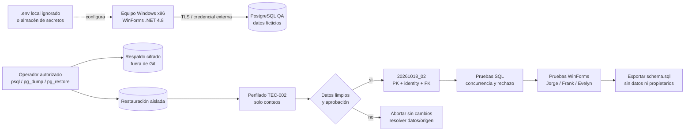

# Diagrama de despliegue TEC-002

La instancia compartida observada no se identifica como QA ficticia y utiliza
un rol propietario. Ninguna contraseña, host ni cadena de conexión forma parte
del diagrama o del repositorio.
