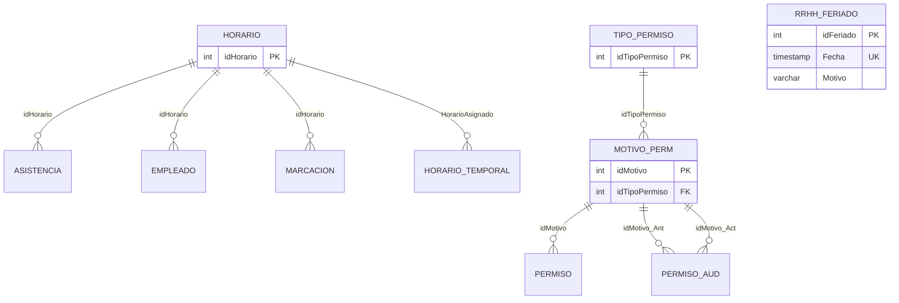

# Diagrama entidad-relación TEC-002

Las referencias son opcionales donde la columna existente admite `NULL`. Todas
las FK usan restricción de borrado (sin cascada). `RRHH_Feriado` no tiene una
relación entrante identificada en `schema.sql`; la unicidad es por
`Fecha::date`, no por timestamp completo.
