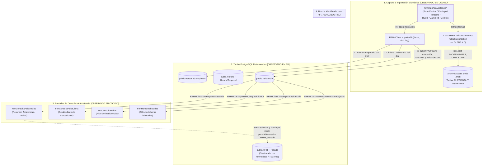

# Diagrama Funcional y Técnico: Registro y Consulta de Asistencia

- **Tarea T2 / Paquete:** `T2-04` (Flujos funcionales) / `TEC-003` (Coordinación y análisis de asistencia).
- **Autor:** Frank Piero Mantilla Arqueros.
- **Revisor asignado:** Jorge Enrique Cano Asto (`T2-04`) / Francisco Kadin Valera Lizarraga (`TEC-003`).
- **Fecha:** 17/10/2026.
- **Alcance:** Análisis funcional y técnico por ingeniería inversa del flujo de importación/registro y consulta de asistencias en `eeeb817`. **Nota de alcance:** Este documento es de diagnóstico e ingeniería inversa para T2; no implica migrar los módulos de asistencia completos en el paquete `TEC-003`.
- **Fuentes inspeccionadas (`eeeb817`):**
  - Importación biométrica: `FrmImportarAsistencia.cs`, `FrmImportarAsistenciaChiclayo.cs`, `FrmImportarAsistenciaTarapoto.cs`, `FrmImportarAsistenciaTrujillo.cs`, `FrmImportarAsistenciaZarumilla.cs`, `FrmImportarAsistenciaZorritos.cs`, `ClassRRHH/AsistenciaAccess.cs`, `ClassRRHH/RRHHClass.cs` (`importarBio`).
  - Consultas de asistencia: `FrmConsultaAsistencias.cs`, `FrmConsultaAsistDiaria.cs`, `FrmConsultaFaltas.cs`, `FrmHorasTrabajadas.cs`, `GRLL.Data/PostgreSqlLegacyContext.cs`.
- **Leyenda de certeza:**
  - `[OBSERVADO EN CÓDIGO eeeb817]`: Flujo y llamadas verificadas por lectura estática y pruebas de módulos (`check-postgresql.cmd -Modules`).
  - `[LIMITACIÓN / STUB EN PUENTE POSTGRESQL]`: Procedimiento original de SQL Server que en `PostgreSqlLegacyContext` o `RRHHClass` aún es un stub o depende de proveedor externo (`Microsoft.Jet.OLEDB.4.0`).

---

## 1. Entradas, procesos, salidas y reglas observadas

| Subflujo | Pantallas / Clases | Entradas | Proceso y reglas observadas en `eeeb817` | Salidas / Persistencia | Estado en `eeeb817` y relación con RF |
|---|---|---|---|---|---|
| **1. Importación biométrica por sede** | `FrmImportarAsistencia*` → `AsistenciaAccess` → `RRHHClass.importarBio` | Rango de fechas (`UcDateTime1` a `UcDateTime2`) y archivo Access `.mdb` de reloj biométrico configurado en `AppSettings` (`RutaBD`, `RutaBDChiclayo`, `RutaBDTarapoto`, `RutaBDTrujillo`, `RutaBDZarumilla`, `RutaBDZorritos`). | 1) `AsistenciaAccess` abre conexión OLEDB (`Microsoft.Jet.OLEDB.4.0`) al `.mdb` local de la sede y consulta `CHECKINOUT` + `USERINFO` (`BADGENUMBER`, `CHECKTIME`, `CHECKTYPE`). 2) Por cada marcación llama a `RRHHClass.importarBio(fecha, dni, flag)`. 3) `importarBio` busca al empleado por DNI en `Persona`/`Empleado`, obtiene `CodHorario` desde `HorarioTemporal` para ese día y clasifica en turno mañana (`flag == 1`, actualiza `HorIngM`/`HorSalM` y `FaltaM = 0`) o tarde (`flag == 2`, actualiza `HorIngT`/`HorSalT` y `FaltaT = 0`), calculando `Tardanza` en minutos si supera la hora de ingreso más tolerancia (`5` min). | Inserta o actualiza filas en `public."Asistencia"` (`IdEmpleado`, `Fecha`, `HorIngM`, `HorSalM`, `HorIngT`, `HorSalT`, `Tardanza`, `FaltaM`, `FaltaT`, `Permisos`, `Comision`, `CodHorario`). | `[OBSERVADO EN CÓDIGO eeeb817]`. Requiere archivo `.mdb` local de la sede y proveedor `Jet.OLEDB.4.0` (32 bits). En `Software/referencia/AsistenciaImport/` existe una referencia de refactor con patrón Template Method/Strategy fuera de la solución principal. |
| **2. Consulta general de asistencias y faltas** | `FrmConsultaAsistencias.cs` | Rango `UcDateTime1` a `UcDateTime2`, filtro `RadioGroupTipo` (`"A"` Asistencias / `"F"` Faltas) y selección de empleados en `ListView1`. | 1) Calcula en cliente `num` = cantidad de sábados y domingos en el rango (`DateAndTime.Weekday`). 2) Invoca `Module1.DcGrll.spRRHH_GetReporteAsistencia(dni, fi, ff, num)` (que en `PostgreSqlLegacyContext` l. 82 es un stub que devuelve `0`). 3) Invoca `objRRHHClass.GetReporteAsistencia(dni, fi, ff)` sobre `public."Asistencia"` y suma `num` (fines de semana) a `Dias_Asistidos` cuando `RadioGroupTipo == "A"` (l. 758 y 885). 4) **Hallazgo clave para RF-17:** No consulta `public."RRHH_Feriado"`, por lo que los días feriados no laborables dentro del rango no se descuentan de faltas ni se suman a los días asistidos. | Grilla `GridControl1` con acumulado por empleado (`DNI`, `Nombres`, `Dias_Asistidos`, `Dias_Faltos`, `Minutos_Tardanza`, `Permisos_Particulares`, `Comision`, `Total_Horas`) y exportación a Excel (`SaveFileDialog1`). | `[OBSERVADO EN CÓDIGO eeeb817]`. Explica la causa raíz de **RF-17** (feriados no reflejados en el reporte general de asistencia). |
| **3. Consulta de asistencia diaria** | `FrmConsultaAsistDiaria.cs` | Rango de fechas (`UcDateTime1` a `UcDateTime2`), filtro de empleados (`ListView1`) y opciones de marcación (`RadioGroup1` / `RadioGroup2`). | Invoca `RRHHClass.GetReporteAsistDiaria` / `spRRHH_RepAsisdiarria`, que cruza `Asistencia`, `Empleado`, `Persona` y `Horario` en PostgreSQL (`57712` filas verificadas en el rango de prueba de `check-postgresql.cmd -Modules`), permitiendo exportar o abrir el reporte diario (`FrmRepAsistenciaDia`). | Grilla detallada por fecha y trabajador con marcaciones de mañana/tarde, tardanzas, permisos y faltas. | `[OBSERVADO EN CÓDIGO eeeb817]`. Operativo sobre PostgreSQL. |
| **4. Consulta de faltas y horas trabajadas** | `FrmConsultaFaltas.cs`, `FrmHorasTrabajadas.cs` | Rango de fechas y selección de trabajadores. | `FrmConsultaFaltas` filtra los registros donde `FaltaM > 0` o `FaltaT > 0`; `FrmHorasTrabajadas` invoca `RRHHClass.GetReporteHorasTrabajadas` calculando la diferencia entre salidas e ingresos registrados en `public."Asistencia"`. | Grilla de faltas / horas trabajadas por empleado y fecha, exportable a Excel. | `[OBSERVADO EN CÓDIGO eeeb817]`. Operativo sobre PostgreSQL. |

---

## 2. Diagrama del flujo de Importación y Consulta de Asistencia (`eeeb817`)

---

## 3. Limitaciones y observaciones para el informe T2

1. **Dependencia de archivos `.mdb` locales en importación:** Las seis pantallas `FrmImportarAsistencia*` requieren archivos `.mdb` de relojes biométricos en rutas locales configuradas en `App.config` y el motor `Microsoft.Jet.OLEDB.4.0` en proceso de 32 bits (`x86`). Sin archivos `.mdb` físicos de cada sede, la ejecución de importación se documenta a partir del código de `AsistenciaAccess.cs` y `RRHHClass.importarBio`.
2. **Desconexión entre `RRHH_Feriado` y `FrmConsultaAsistencias` (`RF-17`):** Mientras `FrmFeriado` mantiene el catálogo `public."RRHH_Feriado"` (refactorizado en `TEC-003`), `FrmConsultaAsistencias` solo contabiliza sábados y domingos en memoria (`num`) y llama al stub `PostgreSqlLegacyContext.spRRHH_GetReporteAsistencia` (que retorna `0`). Por ello, `TEC-003` deja lista la capa de dominio, aplicación y repositorio de feriados (`IFeriadoRepository`), pero el ajuste del cálculo en el reporte general se mantiene como trabajo separado de `RF-17`.
