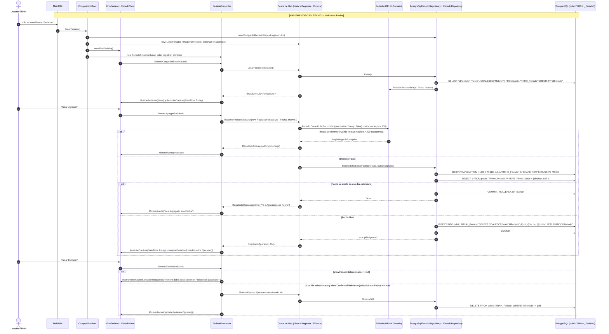
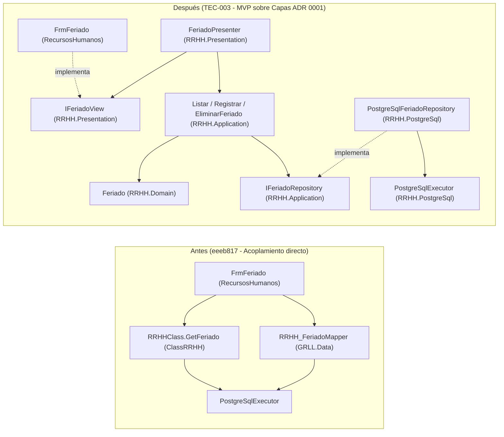

# Diagramas de Gestión de Feriados: Antes (`eeeb817`) vs. Después (`TEC-003`)

- **Paquete / Solicitud:** `TEC-003` / `CR-TEC-003` (preparación de `RF-17`).
- **Autor:** Frank Piero Mantilla Arqueros.
- **Revisor asignado:** Francisco Kadin Valera Lizarraga.
- **Fecha:** 17/10/2026.
- **Fuente y versión base:** Código recuperado y adaptado a PostgreSQL en commit `eeeb817` (`Software/RecursosHumanos/RecursosHumanos/FrmFeriado.cs`, `Software/ClassRRHH/ClassRRHH/RRHHClass.cs`, `Software/GRLL/GRLL.Data/PostgreSqlLegacyMapper.cs`, `BD/schema.sql`).
- **Leyenda de certeza:**
  - `[OBSERVADO]`: Comportamiento verificado en código de `eeeb817` y en la tabla `public."RRHH_Feriado"` desplegada en PostgreSQL (`EV-BD-001`).
  - `[IMPLEMENTADO TEC-003]`: Nuevo flujo desacoplado por capas en la rama `refactor/tec-003-feriados`.
- **Evidencias vinculadas:** [`docs/t2/evidencias/TEC-003/EVIDENCIAS_TEC_003.md`](../../evidencias/TEC-003/EVIDENCIAS_TEC_003.md) (`EV-TEC-001`, `EV-BD-001`, `EV-QA-001`).

---

## 1. Entradas, procesos, salidas y reglas del módulo de Feriados

| Operación | Entradas | Proceso (`eeeb817` vs `TEC-003`) | Salidas y efectos | Reglas de negocio / integridad |
|---|---|---|---|---|
| **Apertura y listado** | Apertura desde `MainMDI` (`ToolStripButton10` o `FeriadosToolStripMenuItem1`). | **Antes:** `FrmFeriado_Load` invoca `RRHH_FeriadoMapper.Instance().SelectAll()` y oculta la columna `"idFeriado"`.<br>**Después:** `MainMDI` abre `CompositionRoot.CrearFeriado()`; `FeriadoPresenter` ejecuta `ListarFeriados` sobre `IFeriadoRepository` y pasa `IReadOnlyList<FeriadoDto>` a `IFeriadoView.MostrarFeriados`. | Grilla `GridControlFeriado` poblada con columnas visibles `Fecha` y `Motivo`, ordenada por identificador. | Los registros históricos con `Motivo` vacío (`6` filas en BD activa) deben reconstituirse sin lanzar excepción para permitir su visualización y eventual depuración. |
| **Alta de feriado** | `Fecha` (`UcDateTime1.Value`) y `Motivo` (`UcTxtMotivo.Text`). | **Antes:** Convierte `Fecha` a string regional (`ToShortDateString()`), consulta `RRHHClass.GetFeriado`, descarga toda la tabla dos veces con `SelectAll()` para calcular `MAX(idFeriado)+1` e inserta sin transacción.<br>**Después:** `FeriadoPresenter` lee `FechaCaptura` y `MotivoCaptura`, delega en `RegistrarFeriado` (que valida con `Feriado.Crear`) y persiste en `PostgreSqlFeriadoRepository` dentro de una transacción con bloqueo de tabla. | Si la fecha ya existe o el motivo es inválido: mensaje de alerta y sin cambios en BD.<br>Si es válido: inserción en `public."RRHH_Feriado"`, recarga de grilla, limpieza de `UcTxtMotivo` y reinicio de `UcDateTime1` a `DateTime.Today`. | 1) Unicidad por día calendario (`"Fecha"::date = @fecha`), independiente del formato regional.<br>2) `Fecha` normalizada a `.Date` (`00:00:00`).<br>3) `Motivo` obligatorio (no vacío tras `.Trim()`) y $\le 200$ caracteres (`character varying(200)` en `BD/schema.sql`). |
| **Eliminación de feriado** | Fila enfocada en `GridView1` (`idFeriado`, `Fecha`). | **Antes:** `btnEliminar_Click` comprueba `FocusedRowHandle`, pide `MessageBox` de confirmación y llama a `RRHH_FeriadoMapper.Instance().Delete`.<br>**Después:** `FeriadoPresenter` verifica `FeriadoSeleccionado`, solicita confirmación mediante `IFeriadoView.ConfirmarEliminacion(fecha)` y ejecuta `EliminarFeriado`. | Si no hay selección: mensaje `"Primero debe Seleccionar un Feriado No Laborable."`.<br>Si cancela: no borra.<br>Si confirma: `DELETE` por `"idFeriado"` y recarga de grilla. | Solo se elimina el registro confirmado por su `"idFeriado"`. |

---

## 2. Flujo actual antes del refactor (`eeeb817` — `[OBSERVADO]`)

En la línea base `eeeb817`, el formulario `FrmFeriado` concentra responsabilidades de interfaz, validación, generación de identificadores en memoria y llamadas a dos componentes heredados distintos (`RRHHClass` y `RRHH_FeriadoMapper`).

```mermaid
sequenceDiagram
    autonumber
    actor U as Usuario RRHH
    participant MDI as MainMDI (WinForms)
    participant Frm as FrmFeriado (WinForms)
    participant CLS as RRHHClass (ClassRRHH)
    participant MAP as RRHH_FeriadoMapper (GRLL.Data)
    participant DB as PostgreSQL (public."RRHH_Feriado")

    Note over MDI,DB: [OBSERVADO en commit eeeb817]
    U->>MDI: Clic en menú/barra "Feriados"
    MDI->>Frm: new FrmFeriado() (sin CompositionRoot)
    Frm->>CLS: new RRHHClass() en constructor
    Frm->>MAP: SelectAll() en FrmFeriado_Load
    MAP->>DB: SELECT * FROM public."RRHH_Feriado" ORDER BY "idFeriado"
    DB-->>Frm: Lista RRHH_Feriado (oculta columna idFeriado)

    U->>Frm: Ingresa Fecha + Motivo y pulsa "Agregar" (BtnAgregar_Click)
    Frm->>CLS: GetFeriado(UcDateTime1.Value.ToShortDateString())
    CLS->>DB: SELECT * FROM public."RRHH_Feriado" WHERE "Fecha"::date = @fecha
    alt Fecha ya existe (Rows.Count >= 1)
        Frm-->>U: MessageBox("Ya a Agregado esa Fecha")
    else Fecha no existe
        Frm->>MAP: SelectAll().Count (lectura completa 1)
        MAP->>DB: SELECT * FROM public."RRHH_Feriado"
        Frm->>MAP: SelectAll().Max(v => v.idFeriado) + 1 (lectura completa 2, sin transacción)
        MAP->>DB: SELECT * FROM public."RRHH_Feriado"
        Frm->>MAP: Insert(rRHH_Feriado) (Fecha conserva hora; Motivo sin validar longitud/vacío)
        MAP->>DB: INSERT INTO public."RRHH_Feriado" ("idFeriado","Fecha","Motivo")
        Frm->>MAP: SelectAll() (llena_leriado)
        Frm-->>U: Grilla recargada y controles reiniciados
    end

    U->>Frm: Pulsa "Eliminar" (btnEliminar_Click)
    alt GridView1.FocusedRowHandle < 0
        Frm-->>U: MessageBox("Primero debe Seleccionar un Feriado No Laborable.")
    else Fila seleccionada y confirmada con MessageBox OKCancel
        Frm->>MAP: Delete(new RRHH_Feriado { idFeriado = id })
        MAP->>DB: DELETE FROM public."RRHH_Feriado" WHERE "idFeriado" = @idFeriado
        Frm->>MAP: SelectAll() (llena_leriado)
        Frm-->>U: Grilla actualizada
    end
```

---

## 3. Flujo refactorizado por capas (`TEC-003` — `[IMPLEMENTADO TEC-003]`)

Con el refactor de `TEC-003`, `MainMDI` solicita la pantalla a `CompositionRoot.CrearFeriado()`, `FrmFeriado` actúa como vista pasiva (`IFeriadoView`), `FeriadoPresenter` coordina la interacción, los casos de uso (`ListarFeriados`, `RegistrarFeriado`, `EliminarFeriado`) aplican las reglas de `Feriado` y `PostgreSqlFeriadoRepository` ejecuta la verificación de fecha duplicada y la inserción de forma atómica con fecha tipada (`DbType.Date`).



---

## 4. Diagrama de dependencias entre capas (Antes vs. Después)


