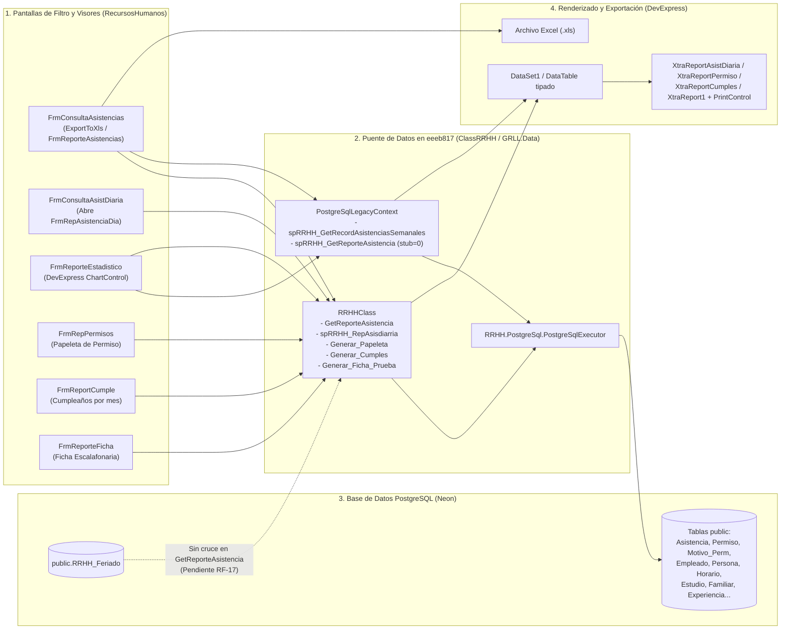

# Diagrama Funcional y Técnico: Generación y Exportación de Reportes

- **Tarea T2 / Paquete:** `T2-04` (Flujos funcionales) / `TEC-003` (Coordinación y análisis de reportes).
- **Autor:** Frank Piero Mantilla Arqueros.
- **Revisor asignado:** Jorge Enrique Cano Asto (`T2-04`) / Francisco Kadin Valera Lizarraga (`TEC-003`).
- **Fecha:** 17/10/2026.
- **Alcance:** Reconstrucción funcional y técnica del subsistema de reportes e impresiones en `eeeb817`. **Nota de alcance:** Análisis documental para T2; no implica migrar los formularios de reportes en `TEC-003`.
- **Fuentes inspeccionadas (`eeeb817`):**
  - Formularios visores y generadores: `FrmRepAsistenciaDia.cs`, `FrmReporteAsistencias.cs`, `FrmRepPermisos.cs`, `FrmReporteEstadistico.cs`, `FrmReportCumple.cs`, `FrmReporteFicha.cs`, `FrmConsultaAsistencias.cs`, `FrmConsultaAsistDiaria.cs`.
  - Plantillas DevExpress XtraReports y DataSets: `XtraReportAsistDiaria.cs`, `XtraReportAsistencia.cs`, `XtraReportPermiso.cs`, `XtraReportCumples.cs`, `XtraReport1.cs` (Ficha personal), `DataSet1.Designer.cs`.
  - Proveedores de datos en `eeeb817`: `ClassRRHH/RRHHClass.cs` y `GRLL.Data/PostgreSqlLegacyContext.cs`.
- **Leyenda de certeza:**
  - `[OBSERVADO Y VERIFICADO EN POSTGRESQL]`: Consultas verificadas con datos reales en `check-postgresql.cmd -Modules` (`semanal=2757`, `detalle=57712`, `cumples=1664`, `ficha=11 tablas`).
  - `[OBSERVADO EN CÓDIGO - LIMITACIÓN DE TABLEADAPTER]`: Flujo que en algún camino secundario aún invoca un `TableAdapter` de `DataSet1` si se entra por una sobrecarga no redirigida.

---

## 1.Inventario de reportes: entradas, procesos, salidas y reglas

| Reporte | Formulario / Reporte DevExpress | Entradas | Proceso y origen de datos en `eeeb817` | Salida | Estado verificado en `eeeb817` |
|---|---|---|---|---|---|
| **1. Reporte de Asistencia Diaria** | `FrmConsultaAsistDiaria` → `FrmRepAsistenciaDia` + `XtraReportAsistDiaria` | Rango `fi`–`ff`, filtro de trabajador/DNI, tipo de marcación, año y mes. | Invoca `RRHHClass.spRRHH_RepAsisdiarria(...)` sobre PostgreSQL (`Asistencia` + `Empleado` + `Persona` + `Horario`), copia las filas a `DataSet1.spRRHH_RepAsisdiarria` y enlaza `PrintControl1` con `XtraReportAsistDiaria`. | Vista previa paginada en `PrintControl1`, impresión o exportación (PDF/XLS) desde barra DevExpress. | `[OBSERVADO Y VERIFICADO EN POSTGRESQL]` (`detalle=57712` filas en prueba de módulos). |
| **2. Reporte General de Asistencias / Faltas** | `FrmConsultaAsistencias` → exportación XLS / `FrmReporteAsistencias` (`XtraReportAsistencia`) | Rango de fechas, tipo (`Asistencias` / `Faltas`) y lista de empleados seleccionados. | `FrmConsultaAsistencias` arma un `DataTable` en memoria invocando `RRHHClass.GetReporteAsistencia(dni, fi, ff)` por cada trabajador seleccionado, sumando sábados/domingos (`num`), y exporta a `.xls` con `GridControl1.ExportToXls`. *(No descuenta ni suma feriados de `RRHH_Feriado`: hallazgo `RF-17`).* | Archivo Excel `.xls` o vista previa en `XtraReportAsistencia`. | `[OBSERVADO EN CÓDIGO]` (pendiente `RF-17` para incorporar feriados). |
| **3. Reporte Estadístico Semanal / Tardanzas y Permisos** | `FrmReporteEstadistico.cs` (`ChartControl`) | Rango de fechas (`UcDateTime1` a `UcDateTime2`), año, trabajador o consolidado. | Consulta `Module1.DcGrll.spRRHH_GetRecordAsistenciasSemanales(fi, ff, dni)` y `RRHHClass.spRRHH_RepAsisdiarria(...)`, poblando series estadísticas en controles `ChartControl` de DevExpress y grillas de resumen. | Gráficos de barras/líneas y tablas comparativas de tardanzas, permisos y asistencias. | `[OBSERVADO Y VERIFICADO EN POSTGRESQL]` (`semanal=2757` filas en prueba de módulos). |
| **4. Papeleta de Salida / Permiso** | `FrmPermiso` → `FrmRepPermisos` + `XtraReportPermiso` | `IdPermiso` seleccionado o recién registrado. | Invoca `RRHHClass.Generar_Papeleta(idPermiso)` que consulta `Permiso`, `Motivo_Perm`, `TipoPermiso`, `Empleado` y `Persona` en PostgreSQL, llena un `DataSet` y lo asigna a `XtraReportPermiso`. | Papeleta lista para imprimir con firmas y horas de salida/retorno. | `[OBSERVADO EN CÓDIGO eeeb817]`. |
| **5. Reporte de Cumpleaños del Personal** | `FrmReportCumple.cs` + `XtraReportCumples` | `Mes` seleccionado (`1`..`12`). | Invoca `RRHHClass.Generar_Cumples(mes)` en PostgreSQL sobre `Persona` y `Empleado`, devolviendo un `DataSet` enlazado a `XtraReportCumples`. | Reporte mensual de onomásticos en `PrintControl1`. | `[OBSERVADO Y VERIFICADO EN POSTGRESQL]` (`cumples=1664` filas para mes=1 en prueba de módulos). |
| **6. Ficha Personal del Empleado** | `FrmFichaPersonal` → `FrmReporteFicha` + `XtraReport1` | `IdEmpleado` seleccionado. | Invoca `RRHHClass.Generar_Ficha_Prueba(idEmpleado)` que ejecuta 11 consultas sobre PostgreSQL (`Persona`, `Empleado`, `Estudio`, `Experiencia`, `Familiar`, `Capacitacion`, `Idioma`, etc.) y arma un `DataSet` de 11 tablas para los subreportes de `XtraReport1`. | Ficha escalafonaria integral en vista previa de impresión. | `[OBSERVADO Y VERIFICADO EN POSTGRESQL]` (`ficha=11 tablas` en prueba de módulos). |

---

## 2. Diagrama de arquitectura y flujo de generación de reportes (`eeeb817`)

---

## 3. Conclusiones técnicas sobre el flujo de reportes

1. **Adaptación de consultas pesadas ya operativa en `eeeb817`:** Las consultas de reporte diario (`spRRHH_RepAsisdiarria`), récord semanal (`spRRHH_GetRecordAsistenciasSemanales`), cumpleaños (`Generar_Cumples`) y ficha escalafonaria de 11 tablas (`Generar_Ficha_Prueba`) ya consultan PostgreSQL a través de `PostgreSqlExecutor` y fueron validadas en ejecución real con `check-postgresql.cmd -Modules`.
2. **Acoplamiento pendiente para etapas posteriores (T3):** Los formularios de reportes aún llaman directamente a `RRHHClass` y `Module1.DcGrll` (`PostgreSqlLegacyContext`) y vuelcan datos en `DataSet1` desde el código de la vista.
3. **Trazabilidad con `RF-17` y `TEC-003`:** El refactor de `TEC-003` sanea el mantenimiento de `public."RRHH_Feriado"` (fechas normalizadas a medianoche, unicidad por día calendario y capa `IFeriadoRepository`), dejando preparado el contrato para que cuando se aborde `RF-17` el caso de uso de reporte de asistencias consulte los feriados del periodo sin tocar la interfaz gráfica.
