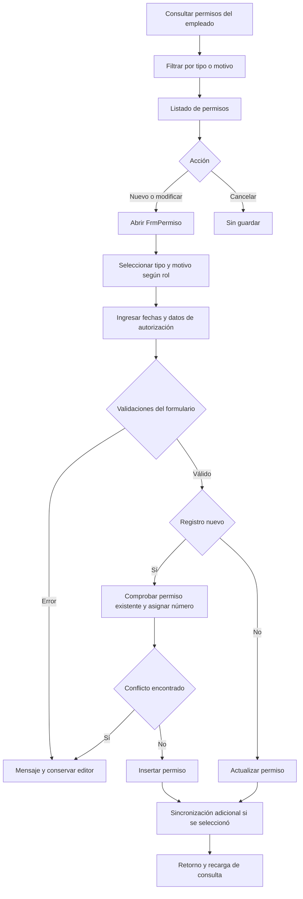
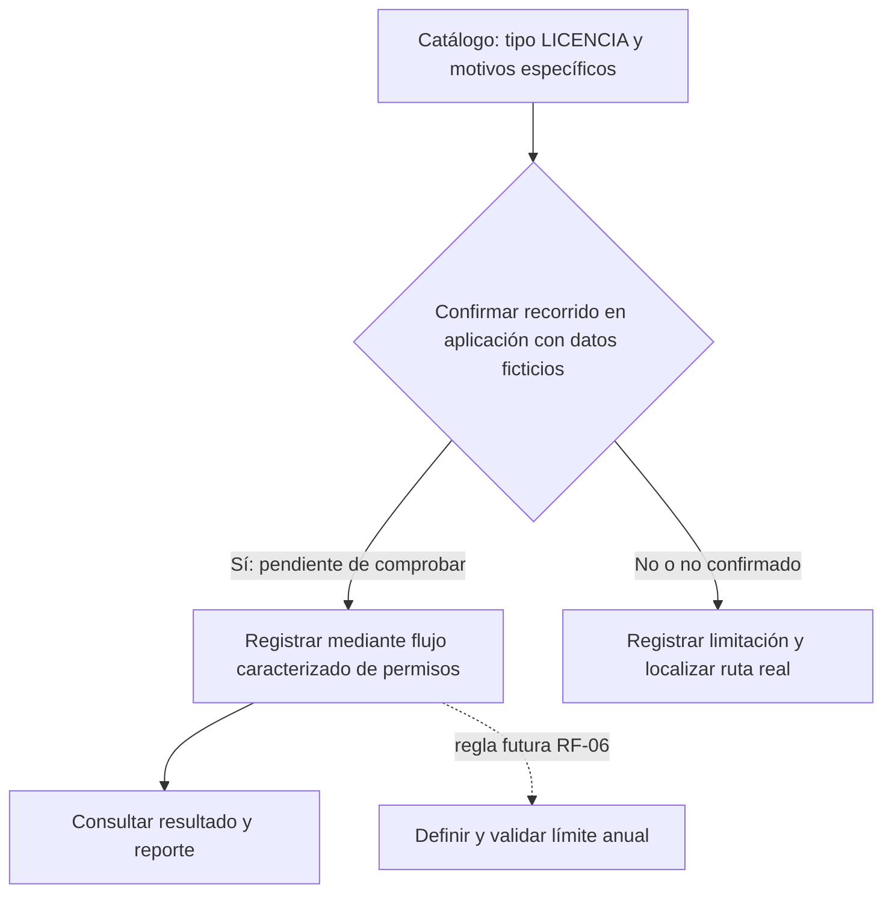
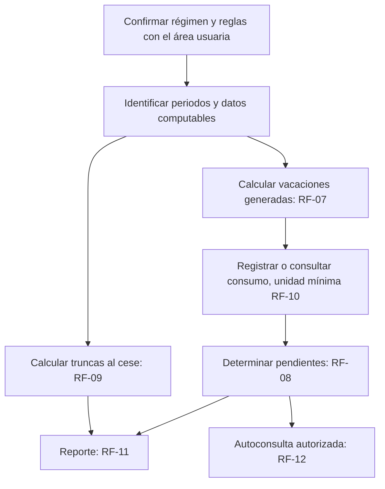

# Flujos funcionales relacionados con permisos, licencias y vacaciones

**Antecedente del paquete TEC-004.** Los diagramas globales AS-IS T2-04
se encargan a Kadin en Bizagi/Modelio según el [plan](../../PLAN_EQUIPO.md#responsables-y-revisión-cruzada).
Las propuestas futuras de este documento no representan funcionalidades
observadas del original ni sustituyen esos entregables.

Responsable: Evelyn Victoria Rodriguez Cardozo. Análisis asistido por IA, 17/10/2026, fuentes de f713383. No se modifican estos módulos como parte del refactor de motivos. Los diagramas se etiquetan según la evidencia disponible; requieren contraste con aplicativo/área usuaria para cerrar ingeniería inversa funcional.

## Permisos: flujo inferido del código

Fuentes: [FrmConsultaPermisos](../../../../Software/RecursosHumanos/RecursosHumanos/FrmConsultaPermisos.cs), métodos Load, Button1_Click, BtnModificar_Click y BtnEliminar_Click; [FrmPermiso](../../../../Software/RecursosHumanos/RecursosHumanos/FrmPermiso.cs), selección de tipo/motivo y Button1_Click.

Entradas: empleado, tipo, motivo, periodo, referencia, autorización y opciones de retorno/día. Proceso: consultas, validaciones y escritura del permiso. Salidas: registro/listado o mensaje de error. La rama de eliminación de la consulta y todas las excepciones requieren caracterización adicional; no se afirma cobertura exhaustiva.

## Licencias: catálogo comprobado, recorrido pendiente

Evidencia: [consulta de catálogos de solo lectura](../../evidencias/TEC-004/catalogos-solo-lectura.txt) en la instancia desplegada: existe tipo 3 «LICENCIA» y motivos de paternidad/sindical/sin goce, además de motivos de licencia dentro del tipo 1. [FrmPermiso](../../../../Software/RecursosHumanos/RecursosHumanos/FrmPermiso.cs) carga tipos y motivos y escribe idMotivo; [FrmRepPermisos](../../../../Software/RecursosHumanos/RecursosHumanos/FrmRepPermisos.cs) rotula «Permiso y/o Licencia». Esto apoya una ruta común; no demuestra un recorrido ejecutado ni la regla anual RF-06. Hay IDs duplicados en el catálogo desplegado: Kadin debe diagnosticar antes de QA de escritura.

Este diagrama combina un catálogo observado, una ruta inferida del código y una dependencia futura; no es una licencia anual implementada. Pendiente: observar una licencia ficticia, identificar tipo/motivo, excepciones y casos de segunda licencia en un año. Entradas/proceso/salidas específicas pendientes de esa confirmación.

## Vacaciones: propuesta para analizar RF-07 a RF-12

La búsqueda estática no identificó un motor específico de cálculo de vacaciones. La consulta de solo lectura del catálogo sí confirmó motivos «VACACIONES», «ADELANTO DE VACACIONES», «1/2 JORNADA VACACIONES» y «PERMISO A CTA DE VACACIONES». Su presencia no prueba cálculo de devengos, saldos o truncas, ni el cumplimiento de RF-07 a RF-12. Registrar una ausencia con ese motivo mediante FrmPermiso es una ruta inferida; requiere recorrido ficticio, contraste con el área usuaria y resolución de IDs duplicados.

Es propuesta futura, no flujo observado ni código del paquete TEC-004. Entradas candidatas: régimen, periodos, devengos, consumo y cese. Procesos y fórmulas pendientes de validación. Salidas esperadas por los RF: generadas, pendientes, truncas, reporte y consulta individual. Para cerrar el análisis funcional: recorrido con usuario, captura real si existe y confirmación explícita de las brechas.

SVG exportados para diapositivas: [diagrama 1](svg/flujos-funcionales-1.svg), [diagrama 2](svg/flujos-funcionales-2.svg), [diagrama 3](svg/flujos-funcionales-3.svg).
