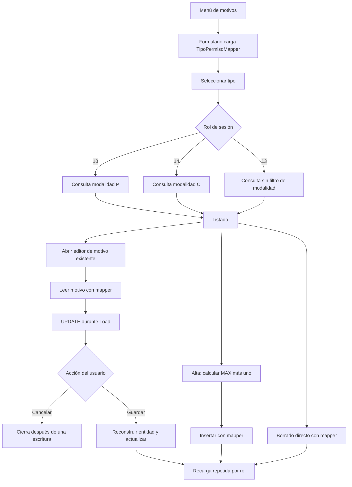
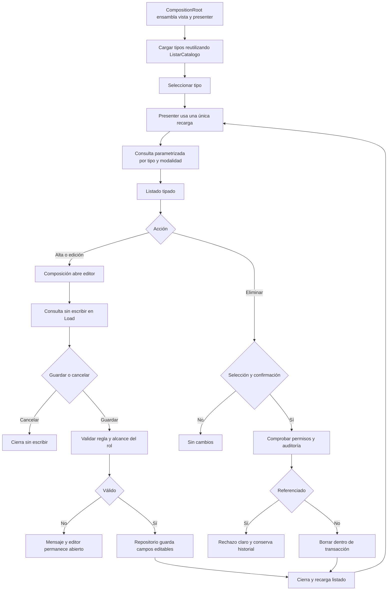
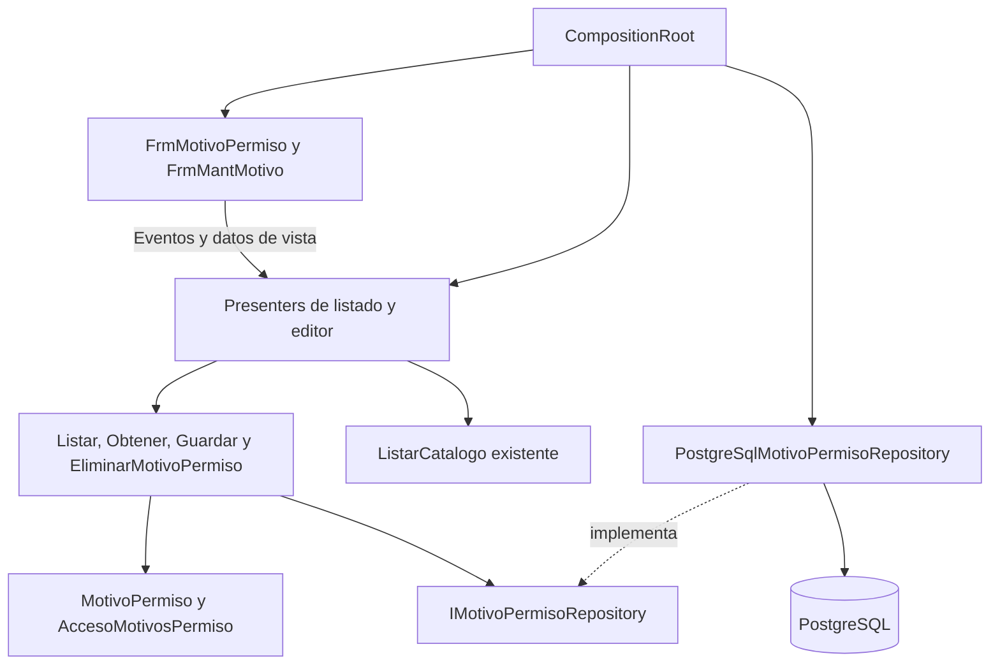

# TEC-004: motivos de permiso antes y después

Responsable: Evelyn Victoria Rodriguez Cardozo. Diagramas elaborados con asistencia de IA el 17/10/2026. Antes: f713383. Después: commit 01db40b en refactor/tec-004-motivos-permiso.

Fuentes: [listado](../../../../Software/RecursosHumanos/RecursosHumanos/FrmMotivoPermiso.cs), [editor](../../../../Software/RecursosHumanos/RecursosHumanos/FrmMantMotivo.cs), [composición](../../../../Software/RecursosHumanos/RecursosHumanos/CompositionRoot.cs). El estado anterior se consulta con `git show f713383:<ruta>`. Inferidos del código; pendientes de contrastar visualmente en Windows. No son capturas del ejecutable original.

## Flujo anterior: inferido de f713383

## Flujo implementado: pendiente de validación visual

## Dependencias implementadas

Los formularios conservan controles GRLL/DevExpress por compatibilidad visual; los presenters no los referencian. Las flechas muestran responsabilidades/llamadas, no un supuesto acceso directo del caso de uso a la implementación concreta. MVP y Repository son patrones; SRP/DRY/DIP son principios; la provisión por constructor desde composición aplica IoC.

## Entradas, procesos y salidas

- Entrada: tipo, selección, descripción, abreviatura, salario y rol proporcionado desde composición.
- Proceso: filtrado por tipo/modalidad, validación, conservación de campos ocultos, transacciones y comprobación de referencias.
- Salida: listado, editor cargado, confirmación, error o persistencia comprobable.
- Cambios de comportamiento deliberados: no UPDATE al abrir; rechazo de entradas inválidas; protección de selección/historial; alta válida en tabla vacía.

SVG exportados para diapositivas: [diagrama 1](svg/motivos-antes-despues-1.svg), [diagrama 2](svg/motivos-antes-despues-2.svg), [diagrama 3](svg/motivos-antes-despues-3.svg).
