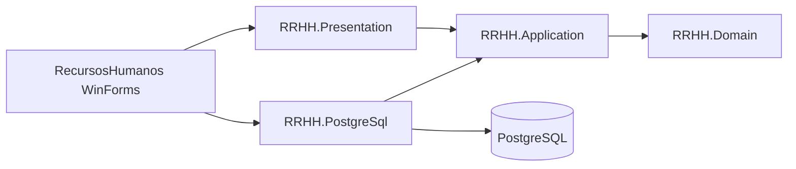

# 6 Arquitectura actual

La [arquitectura vigente](../../../Software/docs/ARQUITECTURA.md) define MVP de vista pasiva con dependencias hacia el dominio. El [ADR 0001](../../../Software/docs/adr/0001-mvp-sobre-capas.md) documenta la decisión.

La vista emite eventos y muestra filas tipadas. El presenter coordina los casos de uso. Los casos validan la entrada y dependen de interfaces. Domain aporta RangoFechas y CalendarioLaboral. PostgreSql implementa el contrato con parámetros y transacciones. CompositionRoot ensambla las dependencias de las pantallas. MainMDI mantiene el acceso del menú tras autenticación.

En el diseño de teletrabajo, la regla inclusiva de solapamiento se mantiene en el dominio y el alta hace la comprobación equivalente bajo bloqueo de PostgreSQL para evitar dos registros concurrentes desde este repositorio. El reporte consulta intersecciones, aplica el calendario y entrega DTO con código de empleado y total. El contrato de tabla y las reglas provisionales están sujetos a revisión.

## Guion para la exposición

1. Explicar qué se recuperó y mostrar la convivencia de pantallas heredadas y migradas en la base `30e4c70`.
2. Recorrer el diagrama desde el clic en MainMDI hasta el repositorio y regresar a la grilla.
3. Mostrar por qué las fechas son tipadas e inclusivas y cómo se impide el solapamiento concurrente.
4. Demostrar los casos con datos ficticios cuando exista evidencia. Indicar los resultados ejecutados y el entorno. Explicar la hipótesis de días laborables y el riesgo de escritores externos.
